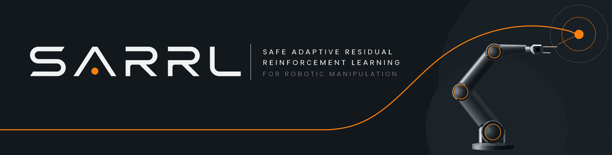
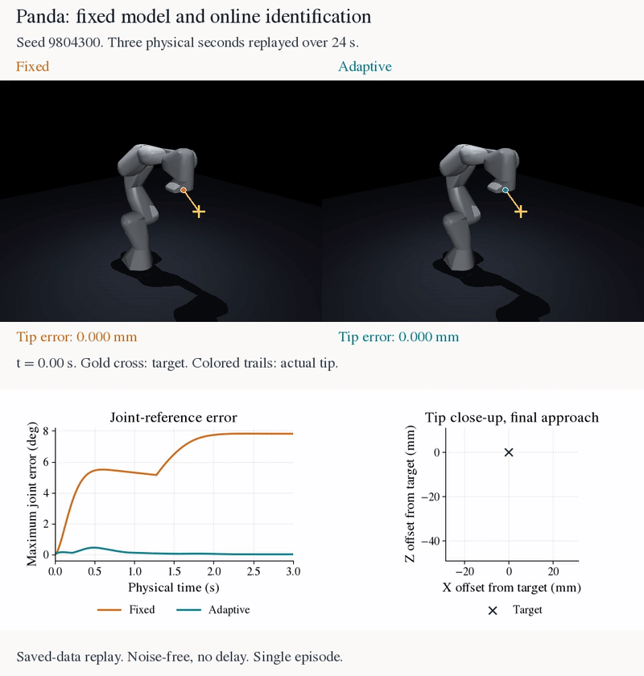
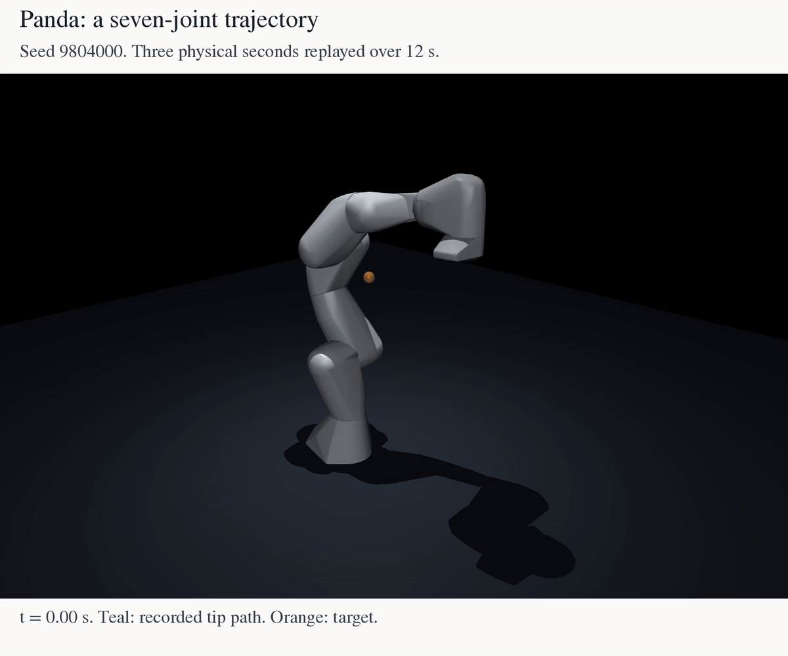
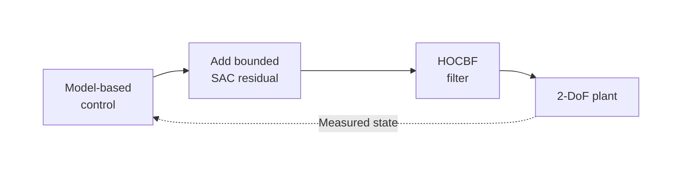
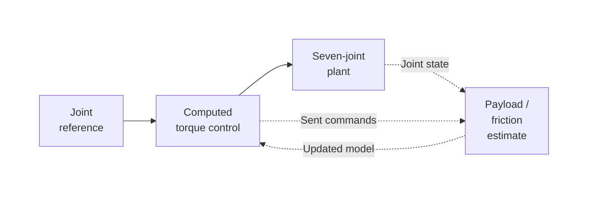
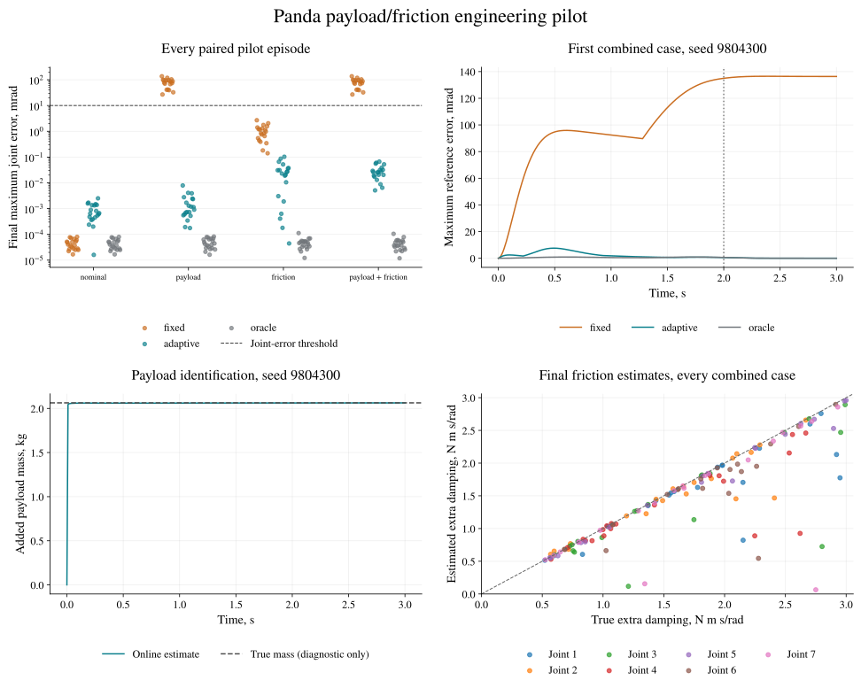
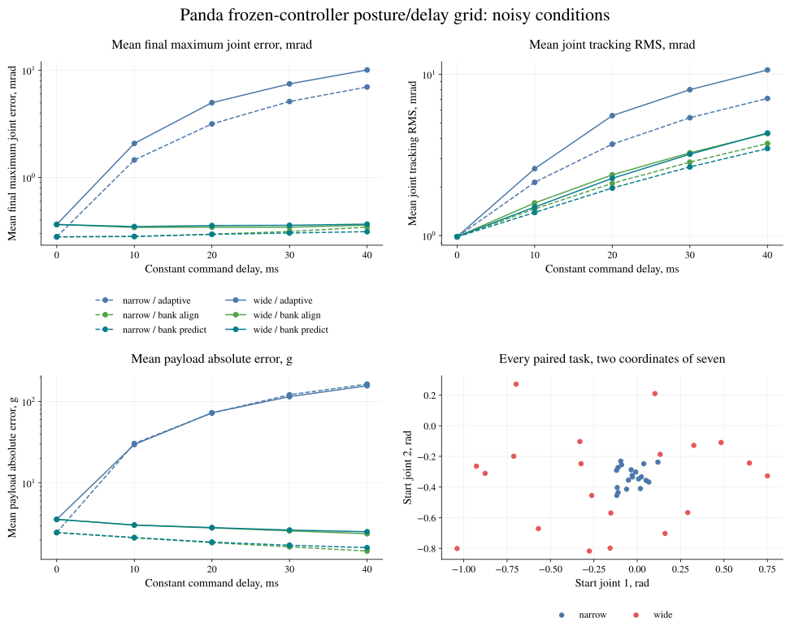
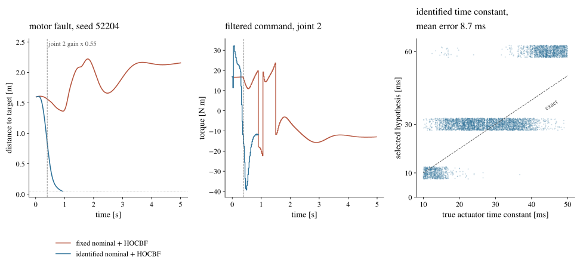

# SARRL

[](https://github.com/andrealo20/SARRL/actions/workflows/ci.yml)
[](https://github.com/andrealo20/SARRL/actions/workflows/dynamic/github-code-scanning/codeql)
[](https://github.com/andrealo20/SARRL/releases/latest)
[](https://www.python.org/)
[](LICENSE)



**SARRL** (Safe Adaptive Residual Reinforcement Learning) is a research stack for robotic control under model mismatch. It started from model-based control with a bounded SAC residual behind an HOCBF safety filter, and keeps every component and every result. The evidence moved the weight of the project: on the planar benchmark, identifying the controller's model online, with the certificate and an uncertainty margin on the same estimate, carries success and safety without learning. A residual trained on top of that controller lost 24.6 points of success, and the calibrated uncertainty gate reduced success in its frozen screen. Negative results are published with their protocols.

Version 2.3 adds a **seven-joint Panda in MuJoCo** with torque control,
online payload/friction identification and command-delay alignment. The
reference platform for residual learning and HOCBF remains the reproducible
**2-DoF planar arm**, available as an analytical model and a MuJoCo plant.
The Panda release covers joint-trajectory engineering benchmarks across two
sampled posture ranges. Prediction and changing-latency variants remain
experimental. Version 2.5 validates the cumulative reference on 4,000 fresh
episodes and profiles 30,000 control cycles. A separate shared-parameter
scoring comparison fails its frozen screen, so cumulative alignment remains
the reference. Version 2.6 completes separate Panda joint-filter and planar
adaptive-residual comparisons. Both candidates fail their frozen screens:
the filter reduces fast-move violations but aborts most tasks, and the
residual loses success against adaptive control. Version 2.7 diagnoses those
failures and tests a delayed Panda backup with validated interval arithmetic on
the normalized model; no branch of the six-period prefix verifies, so that line
is closed. See the [v2.7 guide](docs/v2.7.md) for the backup study, the
[v2.6 guide](docs/v2.6.md) for results and audits, the
[v2.5 guide](docs/v2.5.md) for reference validation, and the
[v2.3 guide](docs/v2.3.md) for the Panda platform.
Hardware and sim-to-real results are not claimed.

## Demo

[](assets/replays/panda_control.mp4)

[Watch the 24-second comparison, 3840 × 2160](assets/replays/panda_control.mp4). Both controllers
follow the same joint reference with the same added payload and friction.
The video replays the first retained paired case, seed `9804300`; three
seconds of physical time are slowed to twenty-four seconds. Both arms move
toward the same target, but the fixed model leaves a visible offset: its tip
ends 37.919 mm from the target, versus 0.009 mm for adaptive. The gold cross
marks the target, colored trails show the actual motion, and both cameras
zoom toward the same target during settling. The right-hand plots show
maximum joint-reference error in degrees and the final approach in physical
millimetres. The GIF preview keeps the same plots below the robot views. This single,
noise-free episode illustrates
the [adaptation pilot](docs/panda-adaptation.md), which retained twenty pairs
per condition. See [demo reproduction](docs/demo.md) for hashes, dependencies
and rendering commands.

### Robot motion and recorded path

[](assets/replays/panda_motion.mp4)

[Watch the 12-second motion replay, 3840 × 2160](assets/replays/panda_motion.mp4). The teal
line follows the recorded attachment-site path; the orange point marks the
target. This is the first nominal pilot episode, seed `9804000`, with three
physical seconds slowed to twelve seconds. It demonstrates joint-trajectory
tracking with a matched model, without adaptation, residual learning or a
safety certificate. Both animations use saved states rather than new physical
simulation steps. Full-resolution MP4 files are linked from the GIFs.

## Selected evidence

| Question | Retained comparison | Scope |
|---|---|---|
| Does residual learning help the fixed planar baseline? | Residual SAC: 56.4% ± 7.0 pp success; fixed nominal: 11.0% | v1.2 held-out benchmark; mean ± training-seed SD over five policies |
| Does online identification help on the MuJoCo planar plant? | 11.7% to 90.9% success in distribution | v2.0, 1,900 paired decision episodes |
| Does an uncertainty margin reduce physical violations? | 11.1% to 0.9% unsafe episodes in distribution | v2.2, 1,900 paired decision episodes |
| Does Panda adaptation handle added payload and friction? | Adaptive 20/20 successful; fixed 0/20 | Descriptive seven-joint pilot, noise-free and without delay |
| Does the joint filter pass the Panda fast-move screen? | Unsafe episodes: 104/120 to 20/120; filtered aborts: 107/120 | v2.6 paired pilot; failed screen |
| Does a residual help the adaptive planar reference? | Primary success: 90.5% adaptive, 65.9% residual mean; difference -24.6 pp | v2.6, five final policies and 100 paired tasks across three scenarios; failed screen |
| Can a delayed Panda backup be verified offline? | 317 of 480 held periods; 0 of 80 branches complete six | v2.7 validated-arithmetic screen on the normalized model, one fixture; line closed |

These are separate comparisons, with different protocols and seed blocks.
The [complete results](docs/results.md) include OOD/fault tests, failed
acceptance decisions, safety tradeoffs and the Panda campaigns.
Protocols and raw evidence are indexed in [experiments](docs/experiments.md);
executed checks are recorded in [verification](docs/verification.md).

## How it works

### Planar: residual learning and safety



### Panda: joint control and identification



The two paths have different evaluated scope. The planar stack combines
model-based control, residual SAC and HOCBF projection; the latest residual
comparison fails to improve the adaptive reference. Panda identification
updates the computed-torque model from causal measured transitions and sent
commands. The diagrams show the reference paths. A separate seven-joint
constraint filter is implemented and evaluated, but fails its advancement screen.


SARRL starts from a physics-based controller and lets SAC learn only a bounded correction:

```math
\tau_{candidate}=\tau_{nominal}+\tau_{residual}
```

This narrows the learning problem to compensating for model mismatch. The repository also includes domain randomization, fault injection, a causal GRU context encoder, residual-dynamics ensembles, uncertainty gating and hard HOCBF projection. Components are modular and independently testable.

## Experiments in pictures

Each figure below comes from retained evidence and is displayed as a scalable
SVG. Click a plot to open it at full size. Full protocols describe the
conditions, sampling and limits.

### Payload and friction identification

[](assets/figures/panda_adaptation.svg)

The first panel compares final joint error for twenty paired tasks in each
load condition: added payload, added friction, and both together. Each dot is
one episode; the vertical axis is logarithmic. Fixed and adaptive control are
compared with an oracle given the true parameters. The second and third
panels follow the first combined case's tracking error and payload estimate.
The fourth compares true and estimated friction across all combined cases.
In the combined condition, adaptive succeeds in 20/20 tasks and fixed
in 0/20. This tests whether updating the controller's model compensates for
physical mismatch. Tracking can improve even when some friction estimates
remain inaccurate. These tasks have no sensor noise or command delay.
[Adaptation protocol](docs/panda-adaptation.md).

### Wider postures and constant delays

[](assets/figures/panda_posture_delay.svg)

The first three panels show mean final joint error, tracking RMS and payload error
under sensor noise, across two sampled posture ranges and constant command
delays from 0 to 40 ms. The fourth panel locates the paired starting postures
using two joint coordinates. Each curve averages twenty paired tasks per cell;
RMS measures error over the trajectory, rather than only at the endpoint.
At wide postures and 40 ms delay, the original
adaptive controller succeeds in 10/20 tasks at each noise level; delay-aware
controllers succeed in all tested cells. This exposes the cost of ignoring
when a command reaches the robot. Constant delays match the bank's candidate
grid; changing latency remains unresolved. Prediction variants are experimental.
[Posture and delay protocol](docs/panda-posture-delay.md).

### Planar adaptive control under a motor fault

[](assets/figures/planar_mujoco.svg)

The first two panels compare fixed and identified control under a motor fault,
behind the same HOCBF filter: one shows distance to the target, the other
shows the filtered torque command for joint 2. The fixed controller times out
in this example while the adaptive controller reaches the target. The third
panel compares true and
estimated actuator time constants across all 5,700 adaptive decision episodes
from v2.0. Together they connect model identification to task execution on
the planar platform, where safety filtering is implemented. The replay seed
was selected by the documented timeout-versus-success rule; its outcome is
illustrative, and model-based filtering does not guarantee physical safety
under mismatch.
[Campaign results](docs/results.md) and [visual reproduction](docs/visuals.md).

The [complete results](docs/results.md) retain the remaining figures and
protocols, including sensor noise, changing latency and score-memory failures.

## Quick start

```bash
git clone https://github.com/andrealo20/SARRL.git
cd SARRL
python -m pip install -e '.[dev]'
pytest -q
```

Run one nominal Panda trajectory after installing the simulator extra:

```bash
python -m pip install -e '.[mujoco]'
python examples/panda_reach.py
```

The example prints a JSON result and writes no files. It is an installation
check using an existing engineering-test seed. See the [release guide](docs/v2.7.md)
for the controller scope, complete evidence and source/runtime requirements
for audits.

For the Python 3.12 reference dependency versions and saved-data video
renderer, follow the [demo reproduction guide](docs/demo.md).

The planar stack requires NumPy, SciPy and PyTorch. The MuJoCo plant needs the optional `mujoco` extra (`pip install -e '.[mujoco]'`); its tests skip without it. Training and evaluation commands are documented in [`docs/experiments.md`](docs/experiments.md).

## Repository guide

- `sarrl/`: dynamics, controllers, RL, adaptation and safety
- `tools/`: training, evaluation and sweep commands
- `tests/`: automated verification
- `artifacts/` and `results/`: retained experimental evidence
- `docs/`: [design](docs/design.md), [mathematics](docs/mathematics.md), [experiments](docs/experiments.md), [verification](docs/verification.md) and [changelog](docs/changelog.md)

## Limitations

Residual learning and HOCBF are evaluated on the planar stack. The Panda
supports joint-trajectory control and online payload/friction identification;
constant on-grid delay alignment is the reference. Changing latency remains
unresolved. Score-only memory worsened noisy tracking in its retained pilot;
joint score/parameter memory failed its changing-age and per-joint tracking
screen. The experimental joint filter reduces fast-move violations but retains
unsafe episodes and frequent aborts. The planar adaptive-residual candidate
fails its success and safety screen. The delayed Panda backup has no verified
prefix, terminal set or simulator binding; its shared-parameter enclosure line
closed after four held substeps completed none of eighty branches. Panda
residual learning, an accepted seven-joint safety filter, hardware and
sim-to-real remain future work.

HOCBF guarantees are relative to the controller model; physical violations
remain possible with model mismatch and delayed actuation. Ensemble
disagreement is not calibrated probability. See [complete results](docs/results.md)
for campaign-specific limitations and [the roadmap](docs/roadmap.md) for next work.

## License and citation

Released under the [MIT License](LICENSE) by [Andrea Loroni](https://github.com/andrealo20).

```bibtex
@software{loroni_sarrl_2026,
  author  = {Andrea Loroni},
  title   = {SARRL: Safe Adaptive Residual Reinforcement Learning for Robotic Manipulation},
  year    = {2026},
  version = {2.7.0},
  url     = {https://github.com/andrealo20/SARRL}
}
```
