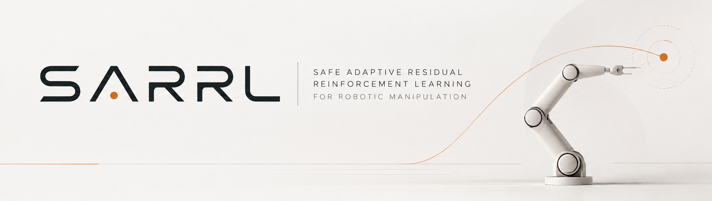
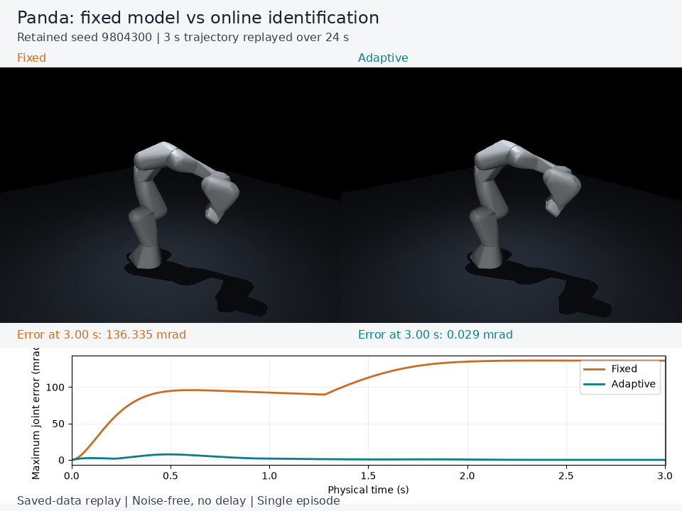

# SARRL

[](https://github.com/andrealo20/SARRL/actions/workflows/ci.yml)
[](https://github.com/andrealo20/SARRL/actions/workflows/dynamic/github-code-scanning/codeql)
[](https://github.com/andrealo20/SARRL/releases/latest)
[](https://www.python.org/)
[](LICENSE)



**SARRL** (Safe Adaptive Residual Reinforcement Learning) is a research stack for robotic control under model mismatch. It combines model-based control with bounded residual reinforcement learning, learned dynamics context, uncertainty-aware policy authority and HOCBF safety filtering.

Version 2.3 adds a **seven-joint Panda in MuJoCo** with torque control,
online payload/friction identification and command-delay alignment. The
reference platform for residual learning and HOCBF remains the reproducible
**2-DoF planar arm**, available as an analytical model and a MuJoCo plant.
The Panda release covers joint-trajectory engineering benchmarks across two
sampled posture ranges. Prediction and changing-latency variants remain
experimental. See the [v2.3 guide](docs/v2.3.md) for scope, a short example
and frozen-data audits. Hardware and sim-to-real results are not claimed.

## Panda demo

[](assets/panda_demo.mp4)

[Watch the 24-second comparison](assets/panda_demo.mp4). Both controllers
follow the same joint reference with the same added payload and friction.
The video replays the first retained paired case, seed `9804300`; three
seconds of physical time are slowed to twenty-four seconds. The graph shows
the maximum joint-reference error. This single, noise-free episode illustrates
the [adaptation pilot](docs/panda-adaptation.md), which retained twenty pairs
per condition. See [demo reproduction](docs/demo.md) for hashes, dependencies
and rendering commands.

## Selected evidence

| Question | Retained comparison | Scope |
|---|---|---|
| Does residual learning help the fixed planar baseline? | Residual SAC: 56.4% ± 7.0 pp success; fixed nominal: 11.0% | v1.2 held-out benchmark; mean ± training-seed SD over five policies |
| Does online identification help on the MuJoCo planar plant? | 11.7% to 90.9% success in distribution | v2.0, 1,900 paired decision episodes |
| Does an uncertainty margin reduce physical violations? | 11.1% to 0.9% unsafe episodes in distribution | v2.2, 1,900 paired decision episodes |
| Does Panda adaptation handle added payload and friction? | Adaptive 20/20 successful; fixed 0/20 | Descriptive seven-joint pilot, noise-free and without delay |

These are separate comparisons, with different protocols and seed blocks.
The [complete results](docs/results.md) include OOD/fault tests, failed
acceptance decisions, safety tradeoffs and the seven Panda pilots.
Protocols and raw evidence are indexed in [experiments](docs/experiments.md);
executed checks are recorded in [verification](docs/verification.md).

## How it works

SARRL starts from a physics-based controller and lets SAC learn only a bounded correction:

```math
\tau_{candidate}=\tau_{nominal}+\tau_{residual}
```

This narrows the learning problem to compensating for model mismatch. The repository also includes domain randomization, fault injection, a causal GRU context encoder, residual-dynamics ensembles, uncertainty gating and hard HOCBF projection. Components are modular and independently testable.

## Quick start

```bash
git clone https://github.com/andrealo20/SARRL.git
cd SARRL
python -m pip install -e '.[dev]'
pytest -q
```

Run one nominal Panda trajectory after installing the simulator extra:

```bash
python -m pip install -e '.[mujoco]'
python examples/panda_reach.py
```

The example prints a JSON result and writes no files. It is an installation
check using an existing engineering-test seed. See the [release guide](docs/v2.3.md)
for the controller scope, complete evidence and source/runtime requirements
for audits.

For the Python 3.12 reference dependency versions and saved-data video
renderer, follow the [demo reproduction guide](docs/demo.md).

The planar stack requires NumPy, SciPy and PyTorch. The MuJoCo plant needs the optional `mujoco` extra (`pip install -e '.[mujoco]'`); its tests skip without it. Training and evaluation commands are documented in [`docs/experiments.md`](docs/experiments.md).

## Repository guide

- `sarrl/`: dynamics, controllers, RL, adaptation and safety
- `tools/`: training, evaluation and sweep commands
- `tests/`: automated verification
- `artifacts/` and `results/`: retained experimental evidence
- `docs/`: [design](docs/design.md), [mathematics](docs/mathematics.md), [experiments](docs/experiments.md), [verification](docs/verification.md) and [changelog](docs/changelog.md)

## Limitations

Residual learning and HOCBF are evaluated on the planar stack. The Panda
supports joint-trajectory control and online payload/friction identification;
constant on-grid delay alignment is the reference. Changing latency remains
unresolved, and finite score memory worsened noisy tracking in the retained
comparison. Panda residual learning, seven-joint HOCBF, hardware and sim-to-real
remain future work.

HOCBF guarantees are relative to the controller model; physical violations
remain possible with model mismatch and delayed actuation. Ensemble
disagreement is not calibrated probability. See [complete results](docs/results.md)
for campaign-specific limitations and [the roadmap](docs/roadmap.md) for next work.

## License and citation

Released under the [MIT License](LICENSE) by [Andrea Loroni](https://github.com/andrealo20).

```bibtex
@software{loroni_sarrl_2026,
  author  = {Andrea Loroni},
  title   = {SARRL: Safe Adaptive Residual Reinforcement Learning for Robotic Manipulation},
  year    = {2026},
  version = {2.3.1},
  url     = {https://github.com/andrealo20/SARRL}
}
```
