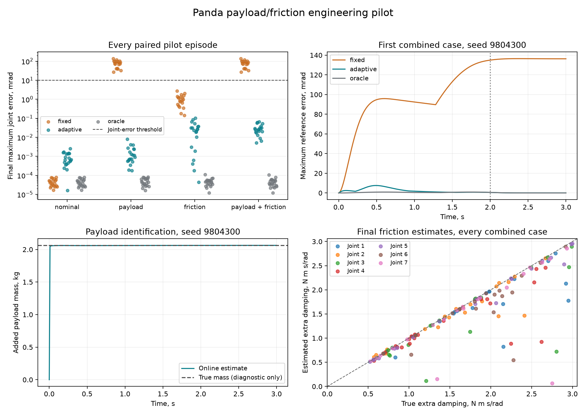

# Panda payload and friction adaptation pilot

This increment compares a fixed nominal controller with an online estimate
on the seven-joint torque interface verified by the [nominal pilot](panda.md).
It keeps that pilot's joint trajectories, controller gains, episode duration
and success criteria. This is a descriptive engineering pilot with twenty
paired seeds per condition, without a statistical acceptance rule.

## Plant and comparison

Four conditions form a payload-by-friction comparison:

| Condition | Added mass | Added viscous friction |
|---|---|---|
| `nominal` | Zero | Zero |
| `payload` | Uniform in 0.5 to 2.5 kg | Zero |
| `friction` | Zero | Uniform in 0.5 to 3 N m s/rad per joint |
| `payload_friction` | Same mass draw as `payload` | Same seven draws as `friction` |

The mass is attached at the known attachment-site location, with the inertia
of a sphere of radius 0.04 m. It has no additional collision geometry. The
arm's geometry and collision meshes are unchanged. Friction adds to the
model's existing 1 N m s/rad damping. Inertial constants are recomputed after
changing the plant model.

Task sampling uses the episode seed. Parameter sampling uses an independent
generator, `default_rng(seed ^ 0x7AD0F)`, drawing mass then seven dampings.
Each seed therefore has the same initial configuration and target across
all conditions and controllers.

Three controllers run on each case:

- `fixed`: the unchanged nominal model, without the extra mass or friction;
- `adaptive`: the same computed-torque law, driven by the online estimate;
- `oracle`: the same law with the true parameters, a privileged diagnostic
  reference excluded from the adaptive-versus-fixed comparison.

The adaptive controller's constructor receives no plant object or true
parameters. Each episode starts a new estimator at zero added mass and
friction. It consumes only sent commands, positions and velocities. There
is no sensor noise or actuator lag in this increment.

## Estimator

With known payload location and spherical inertia proportional to mass,
the inverse dynamics are linear in eight unknowns:

```math
\tau = \tau_0(q,\dot q,\ddot q)
       + \phi_m(q,\dot q,\ddot q)m
       + \operatorname{diag}(\dot q)d,
\qquad \theta=(m,d_1,\ldots,d_7).
```

The payload column is the difference between inverse dynamics with a known
unit payload and with zero payload. Both basis models are private nominal
models. Numerical tests compare the regressor with independently configured
MuJoCo dynamics.

After each 10 ms transition, the estimator evaluates the regressor at the
midpoint of the two measured positions and velocities, with acceleration
`(qd_next - qd) / dt`. Its target is the sent, clipped torque minus nominal
inverse dynamics. It never consumes the simulator's acceleration field.
Finite differencing and the midpoint approximation can leave integration
error even when the physical parameters are within the model's span.

Recursive least squares starts with `theta = 0` and covariance
`diag(9, 25, 25, 25, 25, 25, 25, 25)`. The innovation variance scale is
`1 (N m)^2`; forgetting is one and there is no process noise. A Joseph-form
update maintains the covariance, and each seven-row update clips mass to
`[0, 3.5] kg` and extra damping to `[0, 5] N m s/rad`. Bound hits are counted.
This covariance is an inverse-information matrix, not calibrated predictive
uncertainty or a safety certificate.

The result records estimated parameters, covariance diagonals, information
rank/condition and pre-update innovation RMS. A single reaching trajectory
need not identify every friction parameter well; parameter error and
conditioning must be assessed separately from task tracking.

## Execution and retained outputs

The pilot uses seeds `9804300..9804319` within the registered engineering
block `9804300..9804399`. Tests use `9804200..9804299`. There are 240 new
episodes: four conditions, twenty seeds and three controllers. Before any
new seed is opened, the runner reproduces all twenty retained nominal
episodes on every field. Floats use relative tolerance `1e-9` and absolute
tolerance `1e-10`; the absolute floor covers the nominal pilot's near-zero
final errors. Integer counts, flags and identifiers must agree exactly.
The new pilot has 360,000 physical steps, plus 30,000 for reproduction.

Run from a committed, clean source checkout:

```bash
python -m pip install -e '.[mujoco,dev]'
python -m tools.run_panda_adaptation --episodes 20 --output results/panda_adaptation_run
pytest tests/test_panda_adaptive.py
```

The runner checks the registered seed block against all reachable committed
CSV/JSON/JSONL evidence before starting, records source hashes and runtime
versions, and checks the nominal reproduction before running the new cases.
Each completed cell is written atomically with a hash. An OS-level lock
prevents two runners using the same output directory.

An interrupted pilot can resume with the original arguments plus
`--resume`. Protocol, source commit, source hashes and runtime must match.
Saved cells are validated and kept; a cell without a completed file runs
again. A completed pilot cannot be overwritten, including with `--resume`.
Malformed saved files stop the runner for inspection.

Final outputs are the manifest, reproduction report, canonical episode
records, compressed traces for the first seed of every condition and arm,
summary and a completion marker hashing those files. The raw per-cell files
duplicate these outputs and remain local.

Counts, tracking errors, constraint observations and paired differences are
descriptive. They do not establish performance outside the sampled posture
region, robustness to terms outside this regressor, noise/delay tolerance,
collision prevention, hardware safety or the benefit of residual learning.

## Retained result

On 13 October 2026 the pilot ran once from clean implementation commit
`3086aeb`, under Python 3.12.3, NumPy 2.5.2 and MuJoCo 3.13.0 in WSL, with
one worker and one numerical thread. The history scan covered 160 reachable
commits, 153 distinct trees and 494 evidence blobs without finding the new
seed block. All twenty nominal reference episodes reproduced on every
field before the new cases ran.

Final joint error is the maximum absolute error across the seven joints at
the horizon, averaged across the twenty paired seeds. Values are in mrad.

| Condition | Fixed success | Adaptive success | Fixed final joint error | Adaptive final joint error |
|---|---:|---:|---:|---:|
| Nominal | 20/20 | 20/20 | 0.0000440 | 0.000884 |
| Payload | 0/20 | 20/20 | 78.374 | 0.001713 |
| Friction | 20/20 | 20/20 | 1.018 | 0.028781 |
| Payload + friction | 0/20 | 20/20 | 78.348 | 0.029043 |

The privileged oracle succeeded in all twenty episodes of every condition.
Across the 240 new episodes and 360,000 physical steps, no contact,
joint-position/speed violation or controller saturation was observed.
Including nominal reproduction, execution used 390,000 physical steps.

In the combined condition, mean final tip error fell from 35.870 mm to
0.013621 mm; the oracle reached 0.0000368 mm. Mean tracking RMS, averaged
over the seven joints, fell from 25.251 to 0.885 mrad, against 0.130 mrad
for the oracle. Adaptive final joint error was lower in all twenty pairs
of each perturbed condition. With friction alone, both controllers already
passed the final success thresholds; tracking error distinguishes them.

The combined condition's mean absolute payload error was 0.000663 kg and
mean absolute extra-damping error was 0.188 N m s/rad. Every adaptive
episode had numerical information rank eight, but the combined condition's
information condition number had median `1.63e5` and maximum `1.05e7`.
Some individual friction estimates remain far from their true values,
as the saved-data figure shows. Task success therefore does not imply that
every joint's damping is accurately identified.

On the matched nominal plant, adaptation raised mean final joint error
from `4.40e-8` to `8.84e-7 rad` and estimated mean extra damping of
0.00720 N m s/rad despite zero true added friction. These small errors
are consistent with the estimator's finite-transition approximation.
Clipping occurred in 4,648 of 6,000 nominal estimator updates and 149 of
6,000 combined-condition updates. The bounds and inverse-information
matrix must not be treated as calibrated parameter uncertainty.

These are noise-free, within-model results in a small posture region.
They establish that the eight-parameter adaptation removes the payload
equilibrium error in these sampled tasks. They do not establish tolerance
to measurement noise, delayed actuation or dynamics outside the regressor.
Those effects need a separate pilot before residual learning or safety
filtering is evaluated on this arm.

The [retained evidence](../results/panda_adaptation_pilot) contains the
manifest, reproduction report, 240 episode records, twelve compressed
traces, summary and completion marker. Every completion hash and every
recorded source hash was checked against the saved files and implementation
commit. Later documentation updates do not replace that source snapshot.
The registry now marks this pilot block as used. The launch commands above
document its original execution; a new pilot needs a fresh registered block
and a corresponding runner guard. The retained pilot cannot be overwritten.
Exact numerical reproduction uses the recorded MuJoCo and NumPy versions.
MuJoCo 3.15.0 changes the first nominal episode's maximum torque by
`1.62e-8 N m`, outside the frozen tolerance. Separate regression checks
verify exact equivalence of the original and zero-parameter XML-loading
paths within each engine; they do not relax the pilot's reproduction guard.



The figure uses only the retained episodes and traces, without new physical
steps. To generate another copy:

```bash
python -m pip install -e '.[figures]'
python -m tools.make_panda_adaptation_figure --output results/panda_adaptation_preview.png
```
