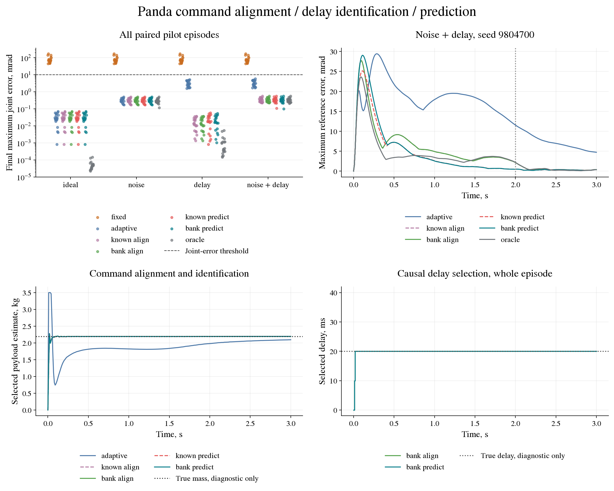

# Panda command-delay identification and prediction pilot

This engineering pilot separates alignment of the identification target,
online delay selection and prediction through the command queue. It builds
on the [noise/delay pilot](panda-robustness.md), which retained 20/20
adaptive successes at every condition but showed increased tracking and
parameter error under a 20 ms delay. This is descriptive, with no statistical
acceptance rule or controller tuning on the new episode block.

## Paired controllers and conditions

The task, physical parameters, noise sequences, torque limits, gains,
three-second horizon and physical-state success criteria stay unchanged.
The four interface conditions are ideal, noise only, 20 ms delay only,
and noise plus delay. Noise SDs remain 0.001 rad and 0.001 rad/s. The delay
FIFO starts with two zeros. The bank contains candidate delays of 0, 10,
20, 30 and 40 ms, although this pilot's true delays are only 0 and 20 ms.

| Arm | Physical parameters | Delay for identification | Predict queued commands |
|---|---|---|---|
| `fixed` | Original nominal | None | No |
| `adaptive` | Original online RLS | Assumes zero | No |
| `known_align` | Online RLS | True delay, privileged diagnostic | No |
| `bank_align` | One RLS per candidate delay | Selected online | No |
| `known_predict` | Online RLS | True delay, privileged diagnostic | Yes |
| `bank_predict` | One RLS per candidate delay | Selected online | Yes |
| `oracle` | True payload/friction, privileged diagnostic | None | No |

Only `known_align` and `known_predict` receive the true delay. Only
`oracle` receives the true payload and friction. Operational bank arms
receive sent clipped commands and the same cached measured pre/post states
as the original adaptive controller. They receive no delivered torque,
plant object, simulator acceleration or true delay. Every episode starts
fresh estimators and empty sent-command histories.

## Identification and prediction

After transition `k`, each delay candidate `L` regresses on `u[k-L]`, or
zero when that command predates the episode. The shared eight-column
regressor uses midpoint measured state and finite-difference acceleration,
as before. Each candidate has the same original RLS prior, bounds and
innovation scale. Its score accumulates the squared norm of the seven-joint
innovation computed before that transition's update. The lowest score
selects the model for the next command; ties choose the lowest delay.
There is no forgetting, process noise, smoothing, score gate or hysteresis.

For a selected delay `L`, prediction propagates the measured state through
the `L` commands already sent that would execute before the new command.
Missing startup commands are zero. Forward acceleration is computed from
the selected payload/friction model's mass matrix and bias, using private
nominal and unit-payload basis models. RK4 uses five 2 ms substeps per
10 ms queued interval. The control reference is evaluated at the same
future time. Tracking is scored against the original current-time reference.

Prediction falls back to the current measured state and current-time
reference if its state becomes non-finite, its dynamics solve fails, or
its position/velocity displacement exceeds 0.5 rad or 3 rad/s from the
initial measured state. Each fallback is counted. These are numerical
guards, not safety certificates. Prediction integration is recorded as
virtual substeps and never added to the physical simulation-step count.

Report final delay correctness, fraction of correctly selected updates,
selection switches and the start of the final uninterrupted correct
selection run. Parameter diagnostics refer to the final selected RLS;
each candidate's estimates and bound-hit counts are also retained.
All covariance semantics remain unchanged and uncalibrated.

Six paired contrasts separate the components: known alignment versus
original adaptive; bank alignment versus original adaptive and known
alignment; known prediction versus known alignment; bank prediction versus
bank alignment and known prediction. Report task success, final and RMS
tracking error, parameter error, clipping and prediction fallbacks for all
arms, including regressions.

## Execution and retained evidence

Reserve `9804700..9804799` before data; this pilot opens `9804700..9804719`.
Engineering tests use `9804600..9804699`. There are 560 new episodes:
twenty paired seeds, four conditions and seven arms, totalling 840,000
physical steps. Before any new seed, reproduce all 240 retained noise/delay
episodes on every field, adding 360,000 steps. Total physical execution is
1,200,000 steps; prediction steps are counted separately.

The runtime must match the reference's NumPy 2.5.2 and MuJoCo 3.13.0.
Reproduction preserves `rtol=1e-9`, `atol=1e-10`, with exact counters and
flags, including nested records. Committed clean sources, history-wide
seed checks, reference completion hashes and an OS-level output lock are
required. Each completed reproduction or new cell is saved atomically
with a hash and validated before pending episodes on resume. A completed
run cannot be overwritten. Resume requires identical source commit,
hashes, protocol and runtime.

```bash
python -m pip install -e '.[mujoco,dev]' 'mujoco==3.13.0' 'numpy==2.5.2'
python -m tools.run_panda_delay --episodes 20 --output results/panda_delay_pilot
```

Use Python 3.12 for the recorded numerical runtime. Retain the manifest,
reproduction report, all 560 episode records, twenty-eight compressed
first-seed traces, summary and completion hashes. Duplicate per-cell
files remain local. Test other true delays, broader postures, actuator
time constants, Cartesian reaching and safety filtering in separate
increments. A successful result here does not establish those capabilities.

## Retained result

The pilot ran once from clean source commit `b7440fe`, with Python 3.12.3,
NumPy 2.5.2 and MuJoCo 3.13.0. The history scan checked 165 reachable
commits, 158 distinct trees and 508 evidence blobs before opening the new
seed block. All 240 previous noise/delay episodes reproduced on every
retained field. The 560 new episodes used `9804700..9804719`; the entire
reserved block remains unavailable for later experiments.

Fixed-model success was 0/20 in every condition; each of the other six
arms achieved 20/20. No contacts, joint-position/speed violations or
saturation were observed. Prediction used 239,400 virtual integration
substeps, in addition to the 1,200,000 physical steps including reproduction.
No prediction fallback occurred.

Mean final maximum joint error and mean tracking RMS, both in mrad.
RMS is calculated per joint over the episode, then averaged over joints
and seeds:

| Arm | Delay: final | Delay: RMS | Noise + delay: final | Noise + delay: RMS |
|---|---:|---:|---:|---:|
| `fixed` | 81.529466 | 28.442463 | 81.561074 | 28.449925 |
| `adaptive` | 3.208822 | 4.105476 | 3.360627 | 4.139280 |
| `known_align` | 0.016352 | 2.273256 | 0.341801 | 2.298004 |
| `bank_align` | 0.016352 | 2.273256 | 0.341801 | 2.298004 |
| `known_predict` | 0.022834 | 1.886656 | 0.339116 | 1.910745 |
| `bank_predict` | 0.021363 | 2.055419 | 0.337742 | 2.076842 |
| `oracle` | 0.001137 | 1.680110 | 0.331603 | 1.691743 |

Without delay, all four new arms retain the original adaptive metrics:
final error 0.031253 mrad and RMS 0.942713 mrad in the ideal condition;
final error 0.319411 mrad and RMS 0.968483 mrad with noise. Known alignment
and bank alignment also match each other's tracking and parameter-error
metrics in both delayed conditions.

With noise plus delay, alignment reduces payload absolute error from
77.809 g to 2.340 g, mean damping absolute error from 0.692690 to
0.106001 N m s/rad, and the fraction of updates hitting parameter bounds
from 56.17% to 2.57%. Bank prediction gives 2.374 g, 0.107126 N m s/rad
and 2.50%, respectively. The main identification gain comes from alignment.
Bank prediction then reduces mean tracking RMS by 9.62% relative to bank
alignment. It does not improve every endpoint: without noise, final error
rises slightly from 0.016352 to 0.021363 mrad while RMS improves.
The privileged known-delay predictor has lower RMS than the online bank
predictor in both delayed conditions.

Each bank selects the correct final delay in all 80 of its episodes. For
the delayed cases it first selects 10 ms, then selects 20 ms after the
second transition at 0.02 s and keeps it for the remaining episode:
299/300 updates select the correct delay. With zero delay it selects zero
from the first update. The zero-initialized queue exposes the delay early;
these results do not test selection from a moving steady state, changing
latency, delays outside the grid, or broader posture and load distributions.

The retained files are in [`results/panda_delay_pilot`](../results/panda_delay_pilot).
Completion hashes and all recorded source hashes were checked against the
retained bytes and frozen Git blobs. A separate saved-data audit recomputed
all 560 success flags, final errors and the summary. For all twenty-eight
301-sample traces it verified exact sensor draws, FIFO-delivered commands,
torque limits, current-time tracking RMS, selected-delay histories and
future references, and recomputed every sent command from its recorded
control state and model. Sampled predictor replays verified queued-state
integration without new physical episodes. The completed-run `--resume`
command refused replacement; hashes remained intact.



The figure includes every episode's final error and the preselected first
noise-plus-delay task's traces. It uses saved data only. Regenerate it at
a new output path, with the `figures` extra installed:

```bash
python -m tools.make_panda_delay_figure --output results/panda_delay_preview.png
```
