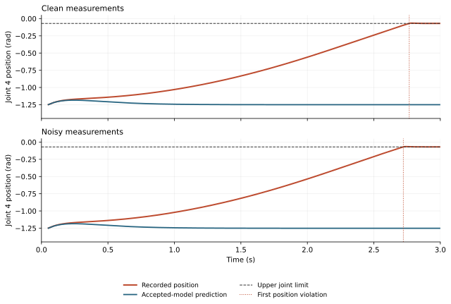

# Panda accepted-prediction discrepancy

The saved-state diagnosis identifies late position drift in both zero-delay
regressions. Joint 4 reaches its upper limit while the accepted frozen model
predicts return to the retained anchor. The controller remains rejected.
No physical trajectory, gain, estimator or seed block is changed.

The [initial velocity review](panda-prediction-gap-methods.md) was frozen at
`b66f3ba8ae6db4ba0ba07cfe989aa143a09f395b`. It revealed that the zero-delay
failures were positional. The separately frozen [position extension](panda-prediction-gap-position-methods.md)
at `e931139878240400bf2936c27d8621e0a5eefa29` preserves that initial output and
adds the missing position identities and curves. Both are post-hoc analyses
of the same 26 aborted episodes, including all eighteen unsafe outcomes.

## The zero-delay failures occur after 2.7 seconds

Both cases use seed `9805800`, accept their final proposal at 0.05 s and
latch backup at 0.06 s. They have no contact or velocity-limit violation.
Their first position violations occur at the following saved substeps:

| Measurements | First violation | Joint | Recorded position | Witness position | Recorded minus witness |
|---|---:|---:|---:|---:|---:|
| Clean | 2.766 s | 4 | -0.068654 rad | -1.250301 rad | +1.181647 rad |
| Noisy | 2.722 s | 4 | -0.068767 rad | -1.251532 rad | +1.182765 rad |

The plot covers the entire retained tail. The dashed line is the upper joint
limit and the dotted line marks the first violating substep. The prediction
approaches its anchor while the physical joint drifts toward its limit.
The full-episode maximum position excess is 4.633 mrad clean and 4.559 mrad
noisy. This is a recorded violation even though the velocity limit is respected.

## Refreshing the state changes the point prediction substantially

At the beginning of that first violating 2 ms substep, apply its saved torque
to three algebraic models. Keep the accepted coefficients for the frozen
model. Then refresh the physical state with the retained estimated parameters.
Finally substitute true payload/friction parameters for an offline diagnostic.
No substitution controls a simulated plant.

| Joint 4 acceleration, rad/s² | Clean | Noisy |
|---|---:|---:|
| Accepted frozen coefficients | -35.588991 | -35.667353 |
| Refreshed state, retained estimates | +1.798897 | +1.941766 |
| Refreshed state, true parameters | -0.233924 | -0.461403 |
| Observed substep-average acceleration | -0.228165 | -0.450416 |

The state replacement contributes +37.387888 and +37.609120 rad/s² to this
point difference. Parameter replacement contributes -2.032821 and -2.403169
rad/s². The remaining observed differences are +0.005759 and +0.010987 rad/s².
These signed components sum to the observed-minus-frozen acceleration; they
do not identify independent causal effects over the full trajectory.
Constraint response, integration and within-substep dynamics may contribute
to the remaining difference. State replacement also includes the initial
measurement-state offset in the noisy case.

At these two points the state-dependent terms have moved far from their
accepted values. The frozen-model terminal argument therefore does not bound
the physical tail. Replacing the online estimate without a new witness would
also invalidate the retained proof; this analysis does not authorize that change.

## Position and velocity accounts close independently

The extended [evidence](../results/panda_prediction_gap_position_v26) retains
all 26 reports and both full focus curves. Maximum identity residuals across
all reviewed physical substeps are `3.27e-13 rad` for position and
`3.13e-13 rad/s` for velocity. Fourteen focused diagnosis/release tests and
separate frozen-source audits pass with zero physical integration calls.

The position error includes the initial sensor offset, its propagated
velocity offset, accumulated transition discrepancy under recorded commands,
and the model response to differences between recorded and predicted commands.
The latter two terms are large and opposing in the focus cases. Their
cancellation prevents interpreting one term as an isolated causal share.
The recorded-command frozen-model trajectory is a diagnostic calculation,
without a feasibility or safe-controller claim.

The earlier [velocity-only evidence](../results/panda_prediction_gap_v26)
remains intact and independently reproducible. Both calculations preserve
the failed integration decision and add no fresh-task evidence.

The next design needs an explicit validity region and error treatment for the
retained backup model, together with a terminal argument that survives that
choice. These selected traces cannot calibrate a new safety reserve or confirm
a model revised after inspecting them. No new comparison starts here.
