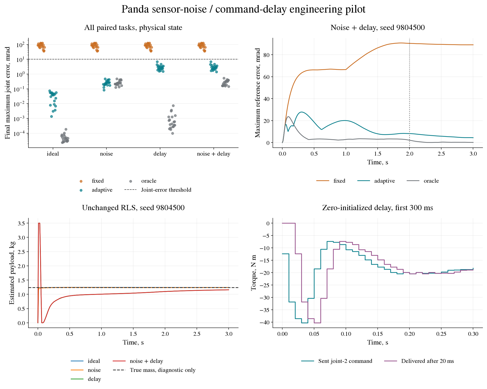

# Panda sensor-noise and command-delay pilot

This descriptive engineering pilot measures the existing fixed, adaptive
and true-parameter diagnostic controllers under noisy measurements and
delayed actuation. It keeps the task, gains and eight-parameter estimator
from the [payload/friction pilot](panda-adaptation.md). No controller is
tuned on these new episodes and there is no statistical acceptance rule.

## Paired design

Every episode has unknown payload mass uniformly drawn in 0.5 to 2.5 kg
and seven extra dampings uniformly drawn in 0.5 to 3 N m s/rad, using the
previous pilot's independent parameter generator. For each seed, all four
conditions and all three arms share the initial state, target and physical
parameters.

| Condition | Position noise SD | Velocity noise SD | Command delay |
|---|---:|---:|---:|
| `ideal` | Zero | Zero | Zero |
| `noise` | 0.001 rad | 0.001 rad/s | Zero |
| `delay` | Zero | Zero | 20 ms |
| `noise_delay` | 0.001 rad | 0.001 rad/s | 20 ms |

These values define engineering perturbations, not measurements of a
particular robot's sensors or drive electronics. The delay is a pure FIFO
of two 10 ms command intervals, not a first-order actuator time constant.

Sensors draw independent Gaussian noise on each joint's position and
velocity at every control boundary, including the initial and final
states. The generator is `default_rng(seed ^ 0x50A07)` and draws fourteen
standard normals in position-then-velocity order, even in zero-noise
conditions. A cached sample is shared by feedback, the transition estimator
and the next control step. Repeated reads do not consume another draw.
Sensor generators are independent of task and parameter generators.
The two noisy conditions use identical exogenous noise sequences across
conditions and arms, although their physical states can differ.

The command chain clips the sent torque to the usual limits, queues it,
then applies the command from two intervals earlier for all five physical
substeps. The FIFO starts with zeros, so the first 20 ms has zero commanded
torque, including gravity compensation. Commands still queued at the
three-second horizon are not flushed. This startup behaviour is part of
the tested condition and is visible in the saved traces.

## Controller inputs and scoring

Every controller receives the same measurement interface. The adaptive
controller remains the previous bounded RLS with a midpoint regressor
and finite-difference acceleration. It receives the current sent command
and cached measured pre/post positions and velocities. It receives no
delivered torque, delay value, sensor-noise sample, simulator acceleration
or true parameters. It has no noise filter or delay hypothesis bank.

The oracle has the true payload and friction parameters, but uses the
same noisy feedback and delayed actuation. It has no advance knowledge of
future noise and no delay compensation. It is a diagnostic reference for
physical-model error, not an optimal controller or a robustness bound.

Tracking, contacts, limits and final success are scored on physical state,
using the original task's thresholds and substep observations. Measurement
errors do not alter the ground-truth success test. Records distinguish
sent and delivered torque, count command mismatches, record observed noise
RMS and hash every exogenous noise sequence. Estimator diagnostics retain
parameter errors, rank/conditioning and bound hits. The covariance remains
an inverse-information matrix without a calibrated uncertainty claim.

## Execution and evidence

Reserve `9804500..9804599` before opening data; this pilot uses the first
twenty seeds, `9804500..9804519`. Tests use `9804400..9804499`. The design
has 240 new episodes and 360,000 physical steps. Before any new seed, the
runner reproduces all 240 retained adaptation episodes on every field,
adding another 360,000 steps. Numeric comparisons keep relative tolerance
`1e-9` and absolute tolerance `1e-10`, including nested estimator records.
Counters and flags must agree exactly. The retained reference's MuJoCo
3.13.0 and NumPy 2.5.2 versions are required for this reproduction.

Use Python 3.12 for the retained numerical runtime. The runner requires
committed clean sources, checks the seed block across
all reachable Git history, verifies the reference's completion hashes,
and records code, protocol and runtime fingerprints. Reproduction cells
and new cells are saved atomically with individual hashes under an
OS-level lock. A mismatch stops execution before any new episode.

```bash
python -m pip install -e '.[mujoco,dev]' 'mujoco==3.13.0' 'numpy==2.5.2'
python -m tools.run_panda_robustness --episodes 20 --output results/panda_robustness_pilot
```

An interrupted run resumes with the same arguments plus `--resume`, only
with matching protocol, commit, source hashes and runtime. Existing cells
are checked before any pending case; malformed evidence stops the run.
A completed pilot cannot be overwritten. Final retained files are the
manifest, reproduction report, all 240 episode records, twelve compressed
first-seed traces, summary and completion hashes. Duplicate per-cell files
remain local.

Report all conditions and all arms, including failures. Compare adaptive
against fixed, each perturbed interface against ideal, and parameter
error separately from task success. Twenty tasks at one noise/delay
setting do not establish a tolerance envelope, population generalisation
or hardware safety. No residual learning or seven-joint safety filter is
introduced in this pilot.

## Retained result

On 13 October 2026 the pilot ran once from clean commit `2fc7a48`, with
Python 3.12.3, NumPy 2.5.2 and MuJoCo 3.13.0 under WSL. The seed scan
covered 163 reachable commits, 156 distinct trees and 501 evidence blobs.
All 240 retained adaptation episodes reproduced on every field before
the new block opened. The new 240 episodes used 360,000 physical steps;
including reproduction, this execution used 720,000 steps.

For every condition, fixed-model success was 0/20, adaptive success 20/20
and oracle success 20/20. No contact, joint-position/speed violation or
controller saturation was observed. Final joint error below is the maximum
absolute error across joints at the horizon, averaged across seeds.
Tracking RMS is averaged over time, joints and seeds. Values are in mrad.

| Interface | Fixed final error | Adaptive final error | Oracle final error | Adaptive tracking RMS |
|---|---:|---:|---:|---:|
| Ideal | 84.531 | 0.033114 | 0.0000537 | 0.977 |
| Noise | 84.515 | 0.263047 | 0.265811 | 1.009 |
| Delay | 84.521 | 2.964439 | 0.001198 | 3.818 |
| Noise + delay | 84.506 | 3.002693 | 0.276642 | 3.824 |

With both perturbations, adaptive mean final tip error was 1.488 mm,
against 0.0153 mm with the ideal interface and 0.1575 mm for the perturbed
oracle. The largest adaptive final joint error was 6.834 mrad, below the
10 mrad criterion. Success therefore stayed at 20/20 despite a roughly
91-fold rise in mean final joint error from the ideal condition. The
combined tracking RMS rose about fourfold; the oracle's combined RMS
was 1.654 mrad.

Parameter identification also degraded:

| Interface | Payload MAE, kg | Extra-damping MAE, N m s/rad | Updates with a bound hit |
|---|---:|---:|---:|
| Ideal | 0.000732 | 0.103 | 1.72% |
| Noise | 0.002187 | 0.108 | 4.37% |
| Delay | 0.068549 | 0.623 | 58.80% |
| Noise + delay | 0.069885 | 0.646 | 54.38% |

All eighty adaptive episodes had numerical information rank eight.
That rank did not prevent biased parameters or frequent clipping. The
unchanged estimator regresses on the current sent command while the
delayed plant receives a previous one. The saved first-seed traces show
the initial payload estimate hitting its 3.5 kg bound and then falling
before slowly recovering. The delay effect includes both the prescribed
zero-torque startup and the continuing FIFO delay; this pilot does not
separate them.

The selected sensor noise raises final error with little change in
adaptive tracking RMS. The chosen delay causes larger tracking and
parameter-error increases. This supports testing a causal delay model
and command-history alignment next, on new seeds, before introducing a
learned residual. It does not establish tolerance to other delay/noise
levels, broader postures, motor faults or hardware operation.

The [retained files](../results/panda_robustness_pilot) include all 240
records, twelve traces, manifest, reproduction report, summary and
completion marker. All output hashes and the recorded source bytes were
verified against the implementation commit. An independent saved-data
audit reconstructed every first-seed sensor sample from its RNG and
checked each delayed command, torque limit and tracking RMS. All 240
success flags were recomputed from physical-state diagnostics. The
completed-run `--resume` command refuses replacement.

The block is now marked used. The earlier command documents the original
launch; a new pilot needs a fresh block and matching runner guard.
The existing records and their source snapshot remain unchanged.



The figure uses saved data only. To create another copy:

```bash
python -m pip install -e '.[figures]'
python -m tools.make_panda_robustness_figure --output results/panda_robustness_preview.png
```
