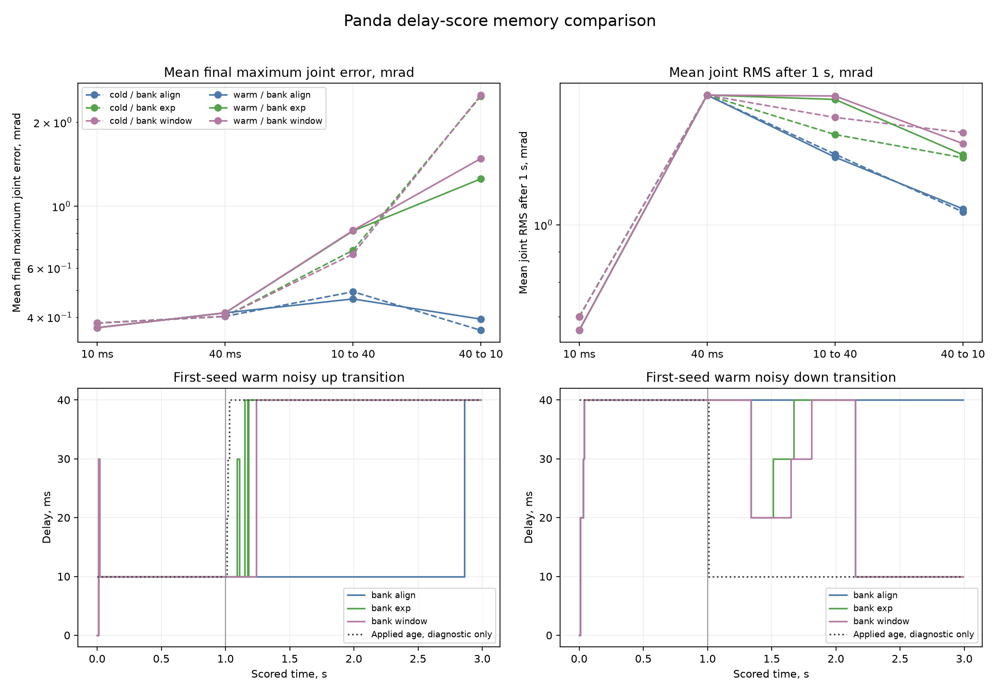

# Panda delay-score memory pilot

The [previous pilot](panda-variable-delay.md) reached every target with
the cumulative-score bank but kept the initial delay after all 160 latency
changes. This descriptive comparison changes only the score memory and
uses fresh paired tasks. There is no acceptance rule, statistical
population claim, parameter sweep or tuning after new seeds open.

## Frozen variants

Keep the original `PandaDelayController` unchanged as `bank_align`.
Add two alignment-only controllers with the same five age hypotheses,
eight-parameter candidate RLS estimators, priors, bounds, covariance
updates, gains and torque clipping. Each innovation is calculated
before updating its candidate estimator. The squared innovation is the
sum over all seven torque components, as in the cumulative baseline.

For exponential scores (`bank_exp`), use
`score[k] = (49/51) * score[k-1] + innovation_squared[k]`, starting at zero.
For windowed scores (`bank_window`), sum the latest fifty innovations,
including the current transition; use every available transition until
fifty exist. Select the smallest score, with the original lowest-age tie
break. Fifty intervals equal a 0.5 s window. The exponential effective
sample size `(1 + decay) / (1 - decay)` is also fifty. These are two fixed
engineering choices, selected before tests and new data, without a search
over memory lengths.

Candidate RLS estimators retain their own complete causal update history
without a parameter-forgetting factor. There are no score or estimator
resets, switch detectors or hysteresis. The controller receives measured state,
sent clipped commands and the control period. It receives no true age,
packet arrivals, delivered torque, switch time, profile or plant object.
Prediction is disabled. The new class uses the original update arithmetic;
tests compare all candidate diagnostics on identical exogenous transitions.

## Paired design

Reuse the previous wide tasks, payload/friction sampling, three-second
scored horizon, packet semantics, change at 1 s, sensor noise and common
0.2 s physical warmup. Keep the physical warmup/main handoff continuous,
with fresh estimators and the four known prior sent commands. Main noise
is paired across all conditions; warmup changes both state and queue.
The variable-delay evaluator adds an opt-in bank factory and arm-list
summary argument. Its default path must reproduce every previous record.
Baseline controller, plant, original interface, packet transport and
model provenance must retain their previous hashes.

Cross cold/warm startup, clean/noisy sensing, fixed 10 ms/fixed 40 ms/
10 to 40 ms/40 to 10 ms profiles and six arms: `fixed`, original `adaptive`,
frozen `bank_align`, privileged `known_align`, `bank_exp`, `bank_window`.
Use twenty fresh paired seeds `9805300..9805319`, reserving the whole
`9805300..9805399` block. Engineering tests use `9805200..9805299`.
Keep the fixed and original adaptive controls even if their previous
performance suggests no benefit. The known-age diagnostic receives actual
applied ages and is excluded from operational claims.

The 1,920 new scored episodes require 2,880,000 physical steps; 960 warmups
add 96,000. Reproduction of all 1,280 previous records adds 1,984,000,
for 4,960,000 physical steps. No arm uses virtual prediction integration.
Four spawned workers each use one numerical thread.

## Metrics and interpretation

Report every cell's success, final maximum joint error, mean per-joint
tracking RMS over all three seconds and before/after 1 s, parameter
errors, bound hits, clipping and physical violations. Safety and total
physical counts include warmup. Report paired memory-minus-cumulative
differences in success, final age correctness, final joint error and
tracking RMS after 1 s, together with warm-minus-cold contrasts.

For all banks, report final age correctness, whole/pre/post-switch correct
selection fractions, final uninterrupted correct-run acquisition delay,
and total/post-switch selection switches. Use the previous definition of
applied command age, including the transitional holds/discards. Acquisition
delay starts at the first interval with stable final applied age and ends
at the post-transition observation establishing the final correct run.
If final selection is wrong, retain absent acquisition. A correct final
selection alone does not imply stable identification; noisy switching and
constant-profile regressions remain part of the result. Better age
selection does not guarantee better tracking because it also changes the
candidate parameters used for control.

## Execution and retained evidence

Commit clean code and this design before new data. Verify previous
completion hashes, source/model provenance, NumPy 2.5.2 and MuJoCo 3.13.0,
and scan all reachable evidence for seed reuse. Reproduce all 1,280
previous episodes on every field before opening new seeds, using the
existing tolerances. Validate every hashed saved cell before pending
work. Resume requires identical commit, sources, runtime, worker count
and protocol; completed output cannot be replaced.

```bash
python -m tools.run_panda_score_memory --episodes 20 --workers 4 \
  --output results/panda_score_memory_pilot
```

Retain manifest, reproduction report, all records, summary, completion
hashes and 96 compressed first-seed traces, including 48 warmups. New
variant traces also contain pre-update scores and each transition's
squared innovations. The public audit reconstructs score weights
independently, replays all eighty first-seed adaptive estimators and checks
saved commands, packet ages, noise and metrics without physical episodes.
Figures use saved data only. Duplicate hashed cells stay local.

```bash
python -m tools.audit_panda_score_memory
python -m tools.make_panda_score_memory_figure
```

This pilot retains one switch time and two on-grid latencies. Multiple
switches, off-grid or stochastic delays, memory calibration, prediction,
residual learning and seven-joint safety filtering are separate work.

## Retained result

The pilot ran once from clean source commit `c4736d4`, on Python 3.12.3,
NumPy 2.5.2 and MuJoCo 3.13.0, with four single-threaded workers. The seed
scan covered 171 reachable commits, 164 distinct trees and 529 evidence
blobs. All 1,280 reference episodes matched on every compared field before
the new seeds opened. No score length or controller was changed afterwards.

All four alignment arms succeeded in 320/320 episodes, original adaptive
in 276/320, and fixed in 0/320. For original adaptive, both noise levels
gave 20/20 at fixed 10 ms and 10 to 40 ms, 12/20 cold at fixed 40 ms and
40 to 10 ms, and 17/20 warm at those latter profiles. Every alignment
condition retained 20/20.

No contacts or position/speed violations occurred, including warmup.
Original adaptive clipped in 48 episodes and 192 scored intervals.
Each alignment arm clipped in the same twelve scenario/seed cases,
74 scored intervals per arm, all on seed `9805303`; fixed and all warmups
had zero clipping. These observations do not establish a safety certificate.

### Age selection

| Score rule | Correct final age, constant profiles | Correct final age, changing profiles | Mean post-switch correct fraction, changing profiles | Mean post-switch selection switches, changing profiles |
|---|---:|---:|---:|---:|
| Cumulative | 160/160 | 1/160 | 0.55% | 0.00625 |
| Exponential | 159/160 | 74/160 | 33.30% | 2.61250 |
| Fifty-transition window | 152/160 | 72/160 | 39.93% | 3.44375 |

The changing-profile counts split as follows. Each cell contains twenty
paired tasks; these are descriptive counts across the retained conditions.

| Startup | Sensing | Change | Cumulative | Exponential | Window |
|---|---|---|---:|---:|---:|
| Cold | Clean | 10 to 40 ms | 0/20 | 1/20 | 0/20 |
| Cold | Clean | 40 to 10 ms | 0/20 | 0/20 | 0/20 |
| Warm | Clean | 10 to 40 ms | 0/20 | 4/20 | 1/20 |
| Warm | Clean | 40 to 10 ms | 0/20 | 0/20 | 0/20 |
| Cold | Noisy | 10 to 40 ms | 0/20 | 20/20 | 20/20 |
| Cold | Noisy | 40 to 10 ms | 0/20 | 10/20 | 11/20 |
| Warm | Noisy | 10 to 40 ms | 1/20 | 20/20 | 20/20 |
| Warm | Noisy | 40 to 10 ms | 0/20 | 19/20 | 20/20 |

Most recovery occurred with sensor noise: exponential selection ended
correct in 69/80 noisy changes and 5/80 clean changes; the window in
71/80 and 1/80 respectively. The privileged diagnostic aligned every
transition correctly. For the episodes ending correctly after a change,
median final uninterrupted acquisition delay was 0.455 s for exponential
(74 episodes, range 0.05 to 1.90 s) and 0.325 s for the window (72 episodes,
range 0.12 to 1.82 s). The cumulative bank's one acquisition took 1.83 s.
These conditional medians exclude the 86 and 88 absent acquisitions;
they do not summarize all changing episodes.

Shorter memory also lost constant-profile correctness. The exponential
failure was warm clean 10 ms. The window's eight failures were two cold
clean 10 ms, five warm clean 10 ms and one warm clean 40 ms. All noisy
constant profiles ended correctly for both variants. Correct final
selection and stable selection remain separate metrics in the full summary.

### Tracking regressions

In every noisy changing condition, both memory variants increased mean
final joint error and RMS after 1 s relative to the cumulative bank.
The table gives mean final maximum joint error / mean per-joint RMS after
1 s, in mrad. Every listed cell still succeeded in 20/20 tasks.

| Startup | Change | Cumulative | Exponential | Window | Known-age diagnostic |
|---|---|---:|---:|---:|---:|
| Cold | 10 to 40 ms | 0.493384 / 1.316085 | 0.694876 / 1.420655 | 0.673783 / 1.518244 | 0.434402 / 1.478354 |
| Cold | 40 to 10 ms | 0.358644 / 1.051319 | 2.484474 / 1.298138 | 2.504270 / 1.431683 | 0.346828 / 0.953680 |
| Warm | 10 to 40 ms | 0.464884 / 1.300843 | 0.815538 / 1.628543 | 0.818967 / 1.650462 | 0.419403 / 1.460077 |
| Warm | 40 to 10 ms | 0.393379 / 1.064059 | 1.253950 / 1.312854 | 1.483405 / 1.371517 | 0.362771 / 0.947997 |

Exponential after-switch RMS increased by 7.946% to 25.191% across these
four conditions; window RMS increased by 15.361% to 36.180%. Maximum
single-episode final joint error was 0.989597 mrad for cumulative scores,
8.293696 for exponential and 7.830507 for the window. At warm noisy
40 to 10 ms, mean payload error was 4.760 g for cumulative, 23.234 g for
exponential, 27.128 g for the window and 2.497 g for the diagnostic.

The clean changing conditions did not show a uniform tracking gain either.
For cold clean 10 to 40 ms, window after-switch RMS was 1.397150 mrad
versus cumulative's 1.258440, despite lower mean final error. For cold
clean 40 to 10 ms, neither memory variant ended with the correct age.
The full cell summary retains all clean/constant metrics, parameter
errors, clipping, paired differences and startup contrasts.

This comparison does not support replacing cumulative scores with either
fixed memory rule. Score forgetting alone produced partial recovery,
selection switches and tracking regressions. The cumulative bank remains
the reference for further comparisons. The next diagnosis should examine
how candidate parameter fitting and trajectory excitation distinguish age
hypotheses before choosing another memory length; the current data do not
establish the cause of the clean/noisy difference.



The lower panels use the first seed chosen before execution. It happens
to contain the cumulative bank's only successful changing-profile final
selection, so its late recovery is not representative of the other 159
changing cases.

### Evidence and verification

Retained files are the [manifest](../results/panda_score_memory_pilot/manifest.json),
[reproduction report](../results/panda_score_memory_pilot/reproduction.json),
[1,920 records](../results/panda_score_memory_pilot/episodes.json),
[full summary](../results/panda_score_memory_pilot/summary.json),
[96 compressed first-seed traces](../results/panda_score_memory_pilot/traces.json.gz)
and [completion hashes](../results/panda_score_memory_pilot/complete.json).
The traces include 48 warmups and the memory variants' squared innovations
and score sequences. The frozen public audit passed on every record and
trace, including eighty causal estimator replays and independent batch
reconstruction of exponential/window weights at each transition.
It also checked source blobs, model provenance, commands, noise, packet
delivery, phase RMS, clipping and age metrics without physical episodes.

All five completion hashes passed again. Completed-output resume refused
replacement. The saved-data figure was visually inspected. New physical
steps were 2,976,000, including 96,000 warmup steps, or 4,960,000 with
reproduction; virtual prediction substeps were zero. The full local suite
passed with 558 tests and one skip for unavailable local diagnostic
records. All twenty-two new cases passed on isolated MuJoCo 3.15.0.

The retained manifest's `protocol.estimator` prose incorrectly mentions
parameter forgetting. The frozen `PandaRLS` code has no forgetting factor;
its information and covariance updates are cumulative. Only delay-score
memory differs between arms. The manifest is retained unchanged. Release
v2.3 corrects the protocol text for future use without changing controller
arithmetic. Audit these records with the recorded source commit, as shown
in the [release guide](v2.3.md).
