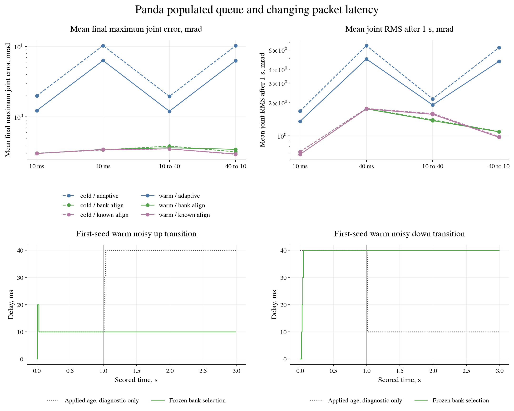

# Panda populated-queue and variable-latency pilot

This descriptive pilot tests the frozen `bank_align` controller after the
[posture/delay grid](panda-posture-delay.md). That grid retained success
and accurate final delay selection but exposed latency through a zero-start
queue. The new inputs remove that startup cue and change latency during
motion. No controller or estimator is tuned on the new data.

## Task, startup and controller inputs

Use the same translated wide tasks, payload/friction distributions, gains,
estimator priors and bounds, three-second scored horizon, limits and
physical-state success criteria. The six controller, plant and original
sensor-interface files and model provenance must match the previous pilot.
The evaluation loop adds prepared-state/interface inputs and optional
phase RMS; its default path must reproduce every previous record.

Cold episodes start at the planned initial posture with zero velocity and
four known zero prior commands. Warm episodes first execute twenty 10 ms
intervals of a common fixed nominal controller holding the planned initial
posture. That controller receives noisy state, knows neither payload nor
friction, and uses the initial profile's constant FIFO delay. Each arm
performs the same physical warmup independently, without rejecting outcomes.

At handoff, retain the physical state and last delivered command, and
provide the last four sent commands to both alignment controllers.
Neither receives warmup state transitions or fitted parameters. All
estimators and scores start fresh. The bank receives no true latency,
packet-arrival metadata, delivered torque or plant object. Main-reference
endpoints stay unchanged, so the warm handoff can start with position and
velocity error. Warmup changes both physical state and queue; its contrast
with cold startup does not isolate queue population alone.

Warmup sensing uses `seed ^ 0xA117` as its interface seed. At handoff the
main interface starts the original episode-seed noise stream, giving all
conditions identical 301 scored sensor draws. Common warmup and handoff
state are paired across arms within a condition. Profiles with different
initial latency can have different warm states. The task, true parameters
and main exogenous noise stay paired across the whole factorial.

## Packet transport and privileged diagnostic

A command sent at interval `k` arrives at `k + d(k)`. At each control
boundary, use the arrived command with the newest sent timestamp. Keep
the last accepted command if nothing new arrives; discard packets older
than a command already accepted. Simultaneous arrivals also keep only
the newest timestamp. There is no queue reset at a latency change.

Four profiles provide controls for both change directions:

| Profile | Sent-command latency before 1 s | Sent-command latency from 1 s |
|---|---:|---:|
| `fixed10` | 10 ms | 10 ms |
| `fixed40` | 40 ms | 40 ms |
| `up` | 10 ms | 40 ms |
| `down` | 40 ms | 10 ms |

Sent-packet latency differs from the age of the command actually applied.
For `up`, applied ages at intervals 100 through 104 are 10, 20, 30,
40 and 40 ms. For `down`, age is 40 ms at interval 100 and 10 ms from
101, while three older packets are discarded. Record both quantities.
The frozen bank still considers fixed ages 0, 10, 20, 30 and 40 ms, with
cumulative pre-update scores and no forgetting or resets.

Compare four arms: `fixed`, original `adaptive`, frozen `bank_align`, and
`known_align`. The last is a privileged diagnostic using the same original
single RLS, with the true applied-command age for each transition. It
aligns the target to known sent history, receives no true physical
parameters, and performs no prediction. It is excluded from operational
claims. Every arm observes the same transport schedule.

## Design and reporting

Cross two startups, two sensor-noise levels (zero or the previous SDs
0.001 rad and 0.001 rad/s), four profiles and four arms on twenty paired
fresh seeds `9805100..9805119`. Reserve the whole `9805100..9805199` block
before data; engineering tests use `9805000..9805099`.

The 1,280 scored episodes use 1,920,000 physical steps; 640 warmups add
64,000. Reproducing all 2,800 previous records adds 4,200,000, for
6,184,000 physical steps. No new arm predicts state. Reproduction's
2,392,000 virtual prediction substeps are counted separately.

Report every cell's success, final maximum joint error, per-joint tracking
RMS, parameter errors, bound hits, clipping and physical violations.
Tracking RMS covers only the scored three seconds, also split at 1 s.
Safety and total physical-step counts include warmup. Retain warmup
diagnostics separately. Report paired bank-minus-adaptive and privileged
known-minus-bank contrasts and compare warm and cold cells explicitly.

For alignment arms, compare each post-transition selected age with the
age applied in that transition. Report final correctness, whole/pre/post
switch correctness fractions and the acquisition time of the final
uninterrupted correct run. Final-regime acquisition delay is measured
from the first interval with the stable final applied age to the
post-transition observation at acquisition; the minimum is one control
period. If selection is wrong at the end, report no acquisition. Preserve
failures and regressions. There is no statistical acceptance rule,
population inference or tuning after the new seeds open.

## Execution and evidence

Commit clean sources before data. Check reference completion hashes,
frozen source/model provenance, NumPy 2.5.2, MuJoCo 3.13.0 and seed reuse
over all reachable history. Reproduce all 2,800 previous episodes on
every field before opening new seeds, retaining the original tolerances.
Four spawned workers each use one numerical thread. Atomic hashed cells
are validated before pending work; resume requires identical source,
runtime, protocol and worker count. A completed output cannot be replaced.

```bash
python -m tools.run_panda_variable_delay --episodes 20 --workers 4 \
  --output results/panda_variable_delay_pilot
```

Retain manifest, reproduction report, all episode records, 64 compressed
first-seed scored traces with their warmup traces, summary and completion
hashes. Duplicate cells stay local. Figures use saved data only. Other
switch times, stochastic/off-grid latency, residual learning, Cartesian
control and seven-joint safety filtering remain separate increments.

Audit the saved files with the recorded NumPy/MuJoCo runtime and frozen
Python sources, without new physical episodes:

```bash
python -m tools.audit_panda_variable_delay
```

## Retained result

The pilot ran once from clean source commit `8900bc6`, on Python 3.12.3,
NumPy 2.5.2 and MuJoCo 3.13.0, with four single-threaded workers. The
seed scan covered 169 reachable commits, 162 distinct trees and 522
evidence blobs without finding the reserved block. All 2,800 previous
records matched on every compared field before the new seeds opened.

Across the 1,280 new episodes, `fixed` succeeded in 0/320, original
`adaptive` in 273/320, and both `bank_align` and privileged `known_align`
in 320/320. The latter two succeeded in 20/20 in every condition. Original
adaptive counts were:

| Startup and sensing | Fixed 10 ms | Fixed 40 ms | 10 to 40 ms | 40 to 10 ms |
|---|---:|---:|---:|---:|
| Cold, clean | 20/20 | 12/20 | 20/20 | 13/20 |
| Cold, noisy | 20/20 | 12/20 | 20/20 | 12/20 |
| Warm, clean | 20/20 | 16/20 | 20/20 | 16/20 |
| Warm, noisy | 20/20 | 16/20 | 20/20 | 16/20 |

No contacts or position/speed violations occurred, including warmup.
Controller clipping affected 44 original adaptive episodes, in 152 scored
control intervals; every other arm and all warmups had zero clipping.
These are observations in the sampled simulator tasks, without a
seven-joint safety certificate.

### Tracking and startup

The table reports noisy conditions. Each entry is mean final maximum
joint error / mean per-joint RMS after 1 s, both in mrad. The second metric
excludes the first second of scored tracking, which contains the warm
handoff transient. The complete summary also retains full-horizon and
pre-switch RMS, clean conditions, parameter errors and paired contrasts.

| Startup | Packet profile | Original adaptive | Frozen bank alignment | Known-age diagnostic |
|---|---|---:|---:|---:|
| Cold | Fixed 10 ms | 1.990034 / 1.673448 | 0.304332 / 0.718607 | 0.304332 / 0.718607 |
| Cold | Fixed 40 ms | 10.266868 / 6.563305 | 0.339243 / 1.768373 | 0.339243 / 1.768373 |
| Cold | 10 to 40 ms | 1.951117 / 2.160262 | 0.385306 / 1.395672 | 0.351259 / 1.591705 |
| Cold | 40 to 10 ms | 10.222875 / 6.289070 | 0.319318 / 1.095348 | 0.294021 / 0.985539 |
| Warm | Fixed 10 ms | 1.230272 / 1.353810 | 0.302174 / 0.679851 | 0.302170 / 0.680093 |
| Warm | Fixed 40 ms | 6.297909 / 4.965548 | 0.345430 / 1.753778 | 0.345127 / 1.754176 |
| Warm | 10 to 40 ms | 1.201621 / 1.902162 | 0.364173 / 1.372440 | 0.351057 / 1.564719 |
| Warm | 40 to 10 ms | 6.275623 / 4.719958 | 0.346783 / 1.087299 | 0.297640 / 0.968923 |

The populated queue did not prevent initial latency identification. On
constant profiles the bank selected the correct final age in all 160
episodes, with final uninterrupted acquisition delays between 0.01 and
0.09 s. Warmup changed the physical initial state and improved original
adaptive success at initial 40 ms. It also increased full-horizon tracking
RMS for the alignment arms: for noisy fixed 40 ms, bank RMS was 7.638753
mrad warm versus 4.345873 cold, while RMS after 1 s was 1.753778 versus
1.768373. This comparison includes both the physical handoff and the
populated queue.

### Latency changes

The bank failed to identify the new regime in all 160 changing-profile
episodes. Every one kept the initial age throughout transitions 100 to
299, both cold and warm, clean and noisy. Final correctness was 0/160 and
final-regime acquisition remained absent. Post-switch correctness was
0.5%, representing only interval 100, when the old command age still
applied. The known-age diagnostic aligned every transition correctly.

The bank still reached all targets with a maximum final joint error below
0.754 mrad. Tracking success therefore does not establish adaptation to
changing latency. Its cumulative scores retain the early regime's
advantage over this three-second horizon. A future comparison should test
score forgetting or a finite window against this frozen baseline on fresh
seeds, with acquisition and tracking reported separately.

Knowing the applied age reduced final error in every changing condition,
but did not always reduce tracking RMS. For warm noisy 10 to 40 ms, known
alignment had after-switch RMS 1.564719 mrad versus the bank's 1.372440;
for 40 to 10 ms it improved RMS to 0.968923 from 1.087299. The diagnostic
changes which RLS transitions are fitted and is not a guaranteed tracking
upper bound. At warm noisy 40 to 10 ms, mean payload error was 3.566 g for
the bank, 2.104 g for the diagnostic and 98.362 g for original adaptive.



### Evidence and checks

Retained files are the [manifest](../results/panda_variable_delay_pilot/manifest.json),
[reproduction report](../results/panda_variable_delay_pilot/reproduction.json),
[1,280 episode records](../results/panda_variable_delay_pilot/episodes.json),
[complete cell summary](../results/panda_variable_delay_pilot/summary.json),
[64 compressed first-seed traces](../results/panda_variable_delay_pilot/traces.json.gz)
and [completion hashes](../results/panda_variable_delay_pilot/complete.json).
The traces include 32 warmups with continuous physical-state handoff.
The public saved-data audit passed for all records and traces, including
48 causal estimator replays. It checked torque calculations, measurement
noise, packet delivery, clipping, phase RMS, delay diagnostics, source
hashes and model provenance without new physical episodes. A completed
`--resume` call refused replacement, and completion hashes passed again.
The figure uses only these saved files and was visually inspected.

New physical steps total 1,984,000, including 64,000 warmup steps;
reproduction brings the total to 6,184,000. Its 2,392,000 virtual prediction
substeps are separate. No controller was changed after the new seeds
opened. This remains a descriptive test of twenty paired tasks, one
switch time and two on-grid latencies.
