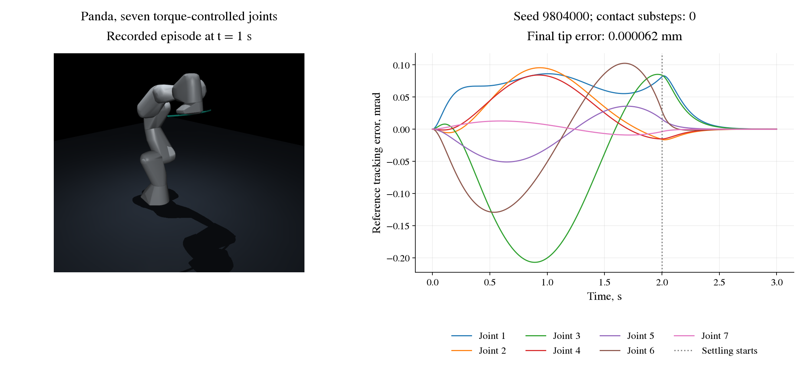

# Panda nominal engineering pilot

The first seven-joint increment verifies torque actuation, a nominal
computed-torque controller and reproducible joint-space trajectories on a
fixed-base Franka Emika Panda without a gripper. It uses MuJoCo and the
packaged collision model derived from Menagerie. See the model's
[attribution and modifications](../sarrl/assets/panda/NOTICE.md).

## Run

From the repository root, install the simulator extra and run the pilot:

```bash
python -m pip install -e '.[mujoco,dev]'
python -m tools.run_panda_nominal --episodes 20 --output results/panda_nominal_run
pytest tests/test_panda.py
```

The output directory must not exist. The runner writes source and model
hashes, runtime versions, initial and final configurations, episode metrics,
the first episode's control-step trace, a summary and a completion marker
hashing those files. The seed block `9804000..9804099` is reserved for this
engineering pilot; tests use `9804100..9804199`. Reruns into new directories
are repetitions of this descriptive pilot, not fresh confirmatory evidence.

## Model and controller

There are seven unit-gear torque motors. The command and delivered actuator
torque agree before the stated limits: 87 N m on joints 1 to 4 and 12 N m on
joints 5 to 7. Position-servo gains and biases are removed. The model retains
Menagerie's joint ranges, inertias, 0.1 kg m2 joint armature and 1 N m s/rad
passive joint damping. Its original collision meshes are used for contacts
and display; the floor is visual only.

The plant and the controller own separate model and data instances. For
this nominal pilot they have the same parameters. The controller consumes
joint positions, joint velocities and the reference, and computes

```math
\tau = M(q)\left[\ddot q_r + 100(q_r-q) + 20(\dot q_r-\dot q)\right]
       + b(q,\dot q) - \tau_{passive}(q,\dot q).
```

The inertia matrix includes armature. The command is clipped to the motor
limits, and controller saturation is counted. Joint errors are direct
differences within bounded joint ranges, without angle wrapping.

## Task and measurements

Each episode samples its initial configuration within 0.12 rad of
`[0, -0.35, 0, -1.8, 0, 1.5, 0.6]`. The target is sampled around the same
posture with per-joint half-widths `[0.4, 0.25, 0.4, 0.3, 0.4, 0.3, 0.4]`
rad. Both endpoints must have 0.15 rad joint-limit clearance. Twenty-one
configurations along the straight joint-space path are checked for contacts;
sampling retries up to 100 times. This discrete precheck does not establish
continuous collision avoidance. Actual contacts are monitored during the
rollout.

A quintic reference moves between the configurations in two seconds with
zero endpoint velocity and acceleration, followed by one second of settling.
The control period is 10 ms and the MuJoCo timestep is 2 ms. Every episode
runs all 300 control steps, including episodes that reach the target early.

At every physical substep the evaluator records any contact, joint-position
excess, speed excess and maximum joint speed. Velocity limits are 2.175 rad/s
on joints 1 to 4 and 2.61 rad/s on joints 5 to 7, from the
[Panda joint specification](https://github.com/frankarobotics/franka_ros/blob/develop/franka_description/robots/panda/joint_limits.yaml).
At the horizon, success
requires all three of:

- maximum joint error at most 0.01 rad;
- maximum joint speed at most 0.05 rad/s;
- attachment-site position error at most 0.01 m.

An episode with a recorded contact or a position/speed violation cannot be
successful. Maximum tracking error, applied torque and saturation are also
reported. The Cartesian target is the forward kinematics of the sampled
joint goal; orientation and redundancy are therefore prescribed by that
goal. There is no Cartesian inverse-kinematics task in this increment.

## Scope

This is a nominal controller and simulator integration check. There is no
online identification, residual policy, HOCBF filter, sensor noise, actuator
delay, external obstacle or added payload. The bounded task uses a small
region around one posture. Passing it does not establish robustness,
general reaching performance, collision prevention or hardware safety.

## Retained result

On 13 October 2026 the pilot ran once on seeds `9804000..9804019`, Python
3.12.3, NumPy 2.5.2 and MuJoCo 3.13.0 under WSL. All 20 episodes succeeded,
over 30,000 physical steps, with no contacts, position/speed violations or
controller saturation. The maximum joint-reference tracking error at the
control samples was 0.386 mrad. The maximum final joint error was
`8.22e-8 rad`, attachment-site position error `7.63e-8 m`, and final joint
speed `6.81e-7 rad/s`. These small final errors are from a matched-model,
noise-free simulation.

Evidence is under [`results/panda_nominal_pilot`](../results/panda_nominal_pilot):
the manifest, 20 episode records, first-episode trace, summary and completion
marker. The run preceded implementation commit `adb2344`; the manifest
records the then-uncommitted changes. All eight recorded source hashes were
subsequently checked against that commit, as recorded in `source_link.json`.
The original manifest and completion marker are retained unchanged.



The figure replays the first recorded episode; rendering does not advance
the simulator. To write a fresh copy, install the `figures` extra and run:

```bash
python -m pip install -e '.[mujoco,figures]'
python -m tools.make_panda_figure --input results/panda_nominal_pilot --output results/panda_nominal_preview.png
```

On headless Linux, select an available MuJoCo OpenGL backend before running
the command, for example `MUJOCO_GL=egl`.

The [payload/friction adaptation pilot](panda-adaptation.md) builds on this
torque interface with a separately specified seven-joint estimator.
Cartesian reaching and safety filtering need their own task definitions
and checks.
