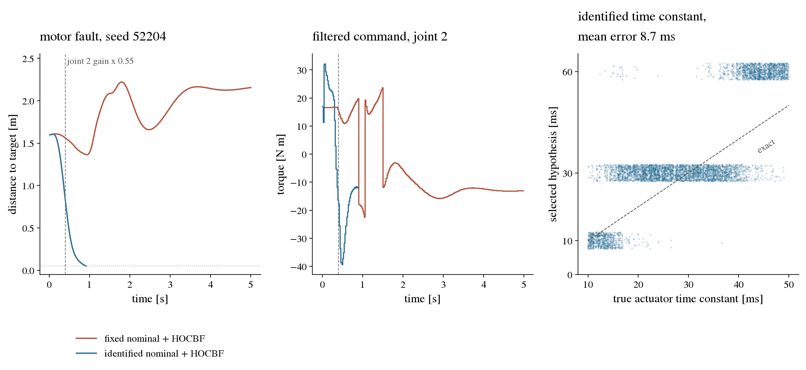
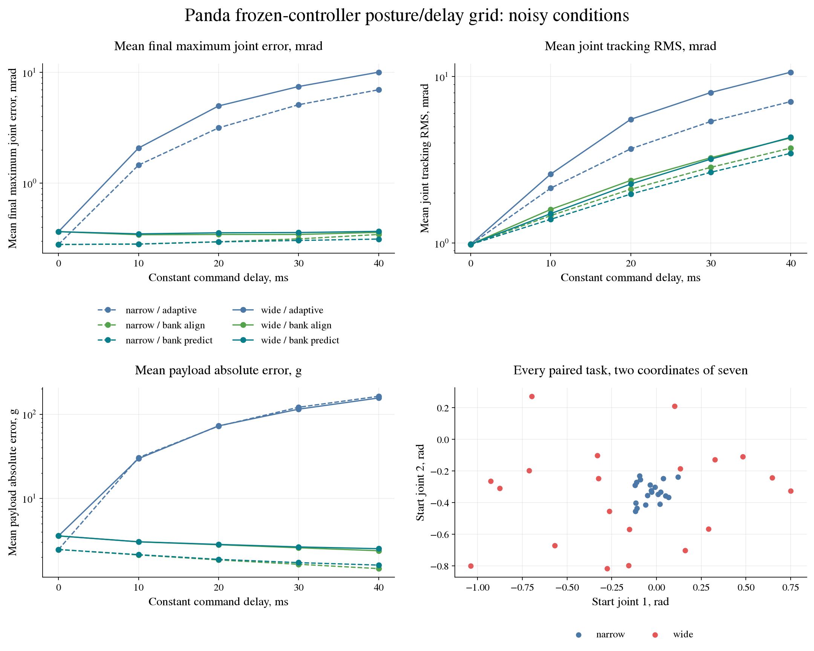

# Retained results

## Control failure diagnosis

The [retrospective analysis](control-failure-results.md) finds that 284/298
model/task successes lost by the planar residual become timeouts. Five failed
first-seed residual traces stop outside the target radius. All 107 Panda
filter aborts reject predicted pending-command intervals before constructing
the QP. Missing complete traces for the 20 unsafe filtered cases prevent
assigning their timing or cause. All 2,580 records and 45 available traces
are retained and audited without new physical steps or confirmation claims.

## v2.6 joint filtering and adaptive residuals

Two separate comparisons fail their frozen advancement criteria. The
[Panda joint filter](panda-joint-filter-results.md) reduces fast unsafe
episodes from 104/120 to 20/120, with 107/120 aborts and success falling
from 16/120 to 13/120. Ordinary moves retain 120/120 successes per arm.

The [planar residual comparison](adaptive-residual-results.md) retains five
fixed-budget policies and 2,100 held-out episodes. ID/fault primary success
is 65.9% for the residual mean against 90.5% for adaptive control. The paired
difference is -24.6 percentage points, with crossed-bootstrap 95% interval
[-32.2, -17.3]. No model has a nonnegative primary difference. The validated
Panda bank and planar adaptive reference remain unchanged. See the
[release guide](v2.6.md) for source, runtime and audit requirements.

## v2.4 Panda parameter memory

The [parameter-memory comparison](panda-estimator-memory.md) reproduced
1,920 prior records and retained 1,920 new paired episodes. Joint memory
completed 320/320 tasks and identified the final age in 99/160 changing
cases, against 83/160 for score-only memory. All three banks identified
160/160 constant final ages. The candidate failed its frozen changing-age
gain and per-joint tracking criteria; cumulative alignment remains the
reference. The protocol links every episode, trace, decision and source hash.

The preceding [saved-trace diagnosis](panda-latency-diagnosis.md) distinguishes
score persistence, candidate parameter compensation and phase-dependent
excitation without new physical episodes. Neither result establishes
reliable changing-latency identification.

## Figure index

The README selects three figures. The full set is linked here; SVG versions
retain legible labels when enlarged. Each protocol states the conditions and
limits of its comparison.

| Figure | What it measures | Protocol |
|---|---|---|
| [Nominal tracking](../assets/figures/panda_nominal.png), [SVG](../assets/figures/panda_nominal.svg) | Recorded tip path and the seven joint errors with a matched model | [Nominal Panda](panda.md) |
| [Payload and friction](../assets/figures/panda_adaptation.png), [SVG](../assets/figures/panda_adaptation.svg) | Paired endpoint errors and online physical-parameter estimates | [Adaptation](panda-adaptation.md) |
| [Noise and delay](../assets/figures/panda_robustness.png), [SVG](../assets/figures/panda_robustness.svg) | Tracking and estimation under sensor noise and delayed commands | [Noise and delay](panda-robustness.md) |
| [Delay alignment and prediction](../assets/figures/panda_delay.png), [SVG](../assets/figures/panda_delay.svg) | Delay selection, command alignment and experimental queue prediction | [Delay identification](panda-delay.md) |
| [Posture and delay](../assets/figures/panda_posture_delay.png), [SVG](../assets/figures/panda_posture_delay.svg) | Tracking and payload error across two posture ranges and five delays | [Posture grid](panda-posture-delay.md) |
| [Changing latency](../assets/figures/panda_variable_delay.png), [SVG](../assets/figures/panda_variable_delay.svg) | Task tracking and failure to recover the changing command age | [Variable latency](panda-variable-delay.md) |
| [Score memory](../assets/figures/panda_score_memory.png), [SVG](../assets/figures/panda_score_memory.svg) | Partial delay recovery and the noisy tracking cost of shorter memory | [Score memory](panda-score-memory.md) |
| [Planar motor fault](../assets/figures/planar_mujoco.png), [SVG](../assets/figures/planar_mujoco.svg) | An outcome-selected task/torque replay and all retained actuator estimates | [Planar campaign](experiments.md) |

### Task success

On the randomized planar held-out benchmark:

| Controller | In distribution (v1.2 held-out) | Compound OOD (v1.3) | Motor fault (v1.3) |
|---|---:|---:|---:|
| Computed torque | 11.0% | 0.0% | 3.0% |
| Direct SAC | 6.0% ± 3.7 pp | n/a | n/a |
| Residual SAC | 56.4% ± 7.0 pp | 6.0% ± 2.3 pp | 23.6% ± 1.9 pp |
| Residual SAC + learned context | **64.2% ± 6.7 pp** | **11.6% ± 3.8 pp** | **32.6% ± 6.4 pp** |
| Residual SAC + uncertainty gate | 15.2% ± 1.6 pp | 0.0% | 3.2% ± 0.8 pp |
| Residual SAC + HOCBF | 49.2% ± 7.9 pp | 3.0% ± 0.7 pp | 16.4% ± 1.1 pp |
| Full adaptive stack | 17.0% ± 2.3 pp | 0.0% | 2.8% ± 0.4 pp |
| **Identified nominal + HOCBF (v1.9, no learning)** | **91.0%** | **85.0%** | **92.0%** |
| Fixed nominal + HOCBF, MuJoCo plant (v2.0) | 11.7% | 0.1% | 3.7% |
| **Identified nominal + HOCBF, MuJoCo plant (v2.0, no learning)** | **90.9%** | **78.9%** | **90.9%** |
| Identified nominal + HOCBF on the fixed model, MuJoCo plant (v2.1) | 85.7% | 34.6% | 58.2% |
| Fixed nominal + HOCBF on the identified model, MuJoCo plant (v2.1) | 11.2% | 0.0% | 2.8% |
| Identified nominal + HOCBF with a constant 2 N m margin, MuJoCo plant (v2.2) | 92.7% | 80.3% | 92.8% |
| Identified nominal + HOCBF with the covariance margin, MuJoCo plant (v2.2) | 90.5% | 78.5% | 90.7% |

The v1.2 campaign established the benefit of residual learning over Direct SAC. The v1.3 campaign reused the frozen policies on new paired seeds: every learned controller degraded sharply under compound OOD dynamics and abrupt motor loss. Learned context retained the highest success, but did not solve robustness. The gate stayed near minimum authority, and hard-HOCBF stacks explicitly rejected 86/3,000 episodes when projection became infeasible.

v1.5 tested whether calibrating that gate fixes the problem. Ensemble
disagreement correlated with prediction error (median Spearman rho `0.298`,
95% CI `[0.228, 0.356]`), but the calibrated gate still reduced success. A4c
lost 13.0 pp versus A2 on ID; A6c lost 12.2 pp versus an otherwise identical
gate-off control. Both preregistered acceptance decisions failed. This is a
retained negative result: disagreement is informative about model error, but
direct residual attenuation is not useful in this benchmark.

v1.6 then tested the link v1.5 had assumed rather than measured, whether
disagreement carries information about *operational failure*, not just about
model error. On the gate-off arm, over a fixed early window and against a
composite endpoint of unsafe episode or HOCBF abort, the per-scenario AUCs were
`0.520` in distribution (24/500 events) and `0.479` under compound OOD (92/500).
The preregistered decision is **Inconclusive**: `ood_compound` excludes an
association above `AUC 0.60`, but `id_reference` does not. Neither establishes
the absence of all weaker associations (weaker effects remain plausible,
particularly because `id_reference` is unresolved), and neither identifies any
causal relationship. The screen used a
decision rule corrected before the data were opened, after the original bound was
found anticonservative; calibrated joint power was only 38.5% at AUC 0.70 against
an 80% target, so a non-rejection is inconclusive, never evidence of absence. The conditional
intervention arm was closed unexecuted.

v1.7 and v1.8 turned to training. Training residual SAC *through* the
required HOCBF filter, instead of bolting the filter on afterwards, cost
**17.3 pp** of in-distribution success (`[-23.6, -9.8]`, all five seeds
negative) with no change in safety, a preregistered **no-go**. Halving the
terminal penalty on filter aborts recovered `+4.5 pp` with an interval crossing
zero and three positive seeds out of five: **inconclusive**. An exploratory
diagnosis on the frozen v1.8 policies then located the failure mode outside the
learned component. Of 3,473 in-distribution timeouts, one ends within 5 cm of
the target; the policies stop short. With the residual removed, the bare
computed-torque nominal stops even farther away, at the equilibrium where the
joint error supplies the torque that balances the real payload and motor gain
against the fixed nominal model. A single integral-augmented nominal removed
that stop on the motivating cases but drove a joint 1.2 rad past its limit on
the fault case, because the HOCBF certificate uses the same fixed model and
predicted `-25.6 rad/s^2` of braking where the plant delivered `-0.1`. That
candidate was vetoed on safety. The nominal controller and the safety
certificate share one model, and both are wrong by the same amount when the
plant departs from it.

v1.9 replaced that fixed model with one identified online. Each joint's
torque equation, divided by its motor gain, is linear in seven parameters
and has the sent command on its left-hand side, so recursive least squares on
the measured velocity identifies masses, inertias, payload, friction and gain
together; one estimator per candidate actuator lag runs in parallel and the
best-fitting lag is used to predict the state at which the next command will
act. The identified model drives both the computed-torque nominal and the
HOCBF certificate. On 1,900 fresh paired episodes per scenario, behind the
same filter, success rose from **12.6% to 90.0%** in distribution, from
**3.1% to 90.2%** under motor fault and from **0.1% to 81.6%** under compound
OOD, while unsafe episodes fell in every scenario (`-4.7`, `-24.3` and
`-10.8 pp`, all intervals excluding zero). The preregistered decision is
**go**. On the v1.3 seeds the adaptive filtered stack reaches 91%, 92% and 85%
success, against 62%, 33% and 12% for the best learned policy on the same
seeds. No learning is involved in this result.

v2.0 moved the plant to MuJoCo and added what the controller does not model:
reflected motor inertia and a first-order actuator lag drawn per episode, and
a noisy measured state handed to every arm. The estimator gained a bank of
actuator time-constant hypotheses alongside its lag hypotheses. Behind the
same filter, on 1,900 fresh paired episodes per scenario, success rose from
**11.7% to 90.9%** in distribution, from **3.7% to 90.9%** under motor fault
and from **0.1% to 78.9%** under compound OOD; unsafe episodes were held in
distribution (`-0.8 pp`, interval covering zero) and fell under fault and OOD
(`-28.5` and `-9.3 pp`), while OOD aborts rose by `3.8 pp`. The preregistered
decision is **go**. Without noise or actuator effects the MuJoCo plant
reproduces the analytical outcomes on the v1.3 seeds in 99..100% of episodes,
so the plant port alone does not move the baseline.

v2.1 asked which use of the estimate carries that result, by crossing the
controller stack (fixed or identified) with the model behind the HOCBF
certificate (fixed or identified) on 1,900 fresh paired seeds per scenario.
The controller stack accounts for most of the success (`+74.4`, `+54.8`
and `+34.6 pp` at a fixed certificate in distribution, under fault and
under OOD), and the certificate's model adds the rest given that stack:
`+32.0 pp` under fault, `+44.7 pp` under OOD, and `+4.3 pp` `[+3.1, +5.4]`
in distribution, where the protocol had preregistered equivalence within
3 points, so the outcome is **partial** with two statements confirmed and
the third failed in the direction of a gain. The certificate's model does
nothing for the fixed controller. On safety the two certificates trade:
the fixed-model certificate intervenes in 53% to 88% of steps and stalls
the arm; the identified one intervenes in 35% to 42%, has more unsafe
episodes in distribution (`+8.5 pp`) and fewer under fault (`-15.3 pp`),
and when it is wrong it is wrong by thousandths of a radian rather than
tenths.

v2.2 tightened the identified certificate by the command error that the
estimator's own covariance allows, and compared it on 1,900 fresh paired
seeds per scenario with the same certificate without a margin and with a
constant 2 N m margin on the same steps. The preregistered outcome is
**confirmed**: the covariance margin cuts unsafe episodes from 11.1% to
0.9% in distribution and from 11.2% to 0.6% under motor fault (`-10.1` and
`-10.6 pp`) for about two points of success (`-1.9` and `-1.8 pp`, lower
bounds `-2.9` against a preregistered `-3`), and goes 1.6 points further
than the constant margin in distribution. Most of the gain is the margin
itself: the constant margin removes `8.5` and `9.8 pp` of unsafe episodes
at no measured success cost and with fewer aborts, while the covariance
margin's extra reduction costs about two points of success and 4.5 to 4.8
points of aborts against it. Under compound OOD both about halve the
violations and the covariance's shape adds nothing.

Left and centre: one motor-fault decision episode on the MuJoCo plant, the
first seed on which the retained log records a timeout for the fixed nominal
and a clean success for the identified one. The joint 2 gain drops to 0.55 at
0.4 s while both arms are mid-motion; the identified nominal reaches the
target at 0.9 s, the fixed nominal drifts and settles about two metres from
it. Right:
the actuator time constant selected by the hypothesis bank against the true
one for all 5,700 adaptive decision episodes; the grid is `{0, 10, 30, 60} ms`
and the selection favours the slower hypothesis from about 40 ms. The figure
is regenerated by `python -m tools.make_v20_figure` from the retained table;
it needs the `mujoco` and `figures` extras (`pip install -e '.[mujoco,figures]'`).

Learned-policy values are means ± sample SD across five independently trained policies, with 100 episodes per policy and scenario. The v1.9 row is a single deterministic controller on the same 100 seeds per scenario (the v1.3 `50000..50099` seeds, run as the reproduction block of the v1.9 campaign); its decision rests on 1,900 further paired seeds per scenario. The two v2.0 rows are the decision block of that campaign: 1,900 paired seeds per scenario (`52200..54099`) on the MuJoCo plant with per-episode armature, first-order actuator lag and a noisy measured state, so they are not seed-matched to the rows above. The two v2.1 rows are the crossed arms of the certificate factorial on 1,900 paired seeds per scenario (`54200..56099`), same plant and options. The two v2.2 rows are the margin arms of the uncertainty-margin campaign on 1,900 paired seeds per scenario (`56200..58099`), same plant and options; its arm without a margin reached 92.5%, 81.6% and 92.6%. These campaign results cover the planar benchmark, analytical and MuJoCo.

### Seven-joint Panda

The Panda uses seven torque motors, an independent controller model and
quintic joint references. Identification estimates payload mass and seven
added viscous-friction terms from causal measured transitions. The model's
collision assets, attribution and file hashes are packaged with the code.

| Check | Retained result | Protocol and evidence |
|---|---|---|
| Nominal tracking | 20/20 successful matched-model trajectories | [Nominal](panda.md) |
| Combined payload/friction | 20/20 adaptive versus 0/20 fixed; mean final joint error 0.029043 versus 78.348 mrad | [Adaptation](panda-adaptation.md) |
| Noise plus 20 ms delay | 20/20 original adaptive; mean final joint error 3.002693 mrad | [Noise/delay](panda-robustness.md) |
| Online delay selection | Both banks selected the correct final delay in 80/80 episodes each | [Alignment and prediction](panda-delay.md) |
| Two postures, constant delays 0 to 40 ms | Bank alignment succeeded in 400/400 and selected every final delay correctly | [Posture/delay grid](panda-posture-delay.md) |
| Warm startup and changing latency | Bank alignment succeeded in 320/320 but kept the initial delay in all 160 changing cases | [Variable latency](panda-variable-delay.md) |
| Exponential/window score memory | All banks succeeded in 320/320; final age recovery improved but noisy tracking regressed | [Score memory](panda-score-memory.md) |
| Candidate parameter memory | 320/320 successes and 99/160 changing final ages; frozen age/tracking criteria failed | [Parameter memory](panda-estimator-memory.md) |
| Fresh constant-delay validation | 1,000/1,000 bank successes and correct final ages; all reference criteria passed | [Validation and timing](panda-reference-results.md) |
| Saved-input control-cycle timing | 30,000 cycles; p99 1.827530 ms, maximum 3.928535 ms, no cycle above 10 ms | [Timing scope](panda-reference-results.md#saved-input-control-cycle-timing) |
| Shared-parameter scoring | 316/320 successes and 96/160 changing final ages; frozen screen failed | [Shared scoring](panda-shared-scoring-results.md) |

These pilots use different fresh seed blocks; their rows are separate
engineering checks. Final joint error is the maximum over joints, averaged
over tasks. Task success includes the measured contact, position and speed
constraints. Privileged diagnostics are labelled separately in each protocol.

At wide postures with noisy 40 ms constant delay, bank alignment reduced
mean final joint error from 10.054279 to 0.359496 mrad and succeeded in
20/20 versus 10/20 for original adaptive. Prediction slightly worsened
tracking RMS there. Cumulative alignment therefore remains the reference.

Changing latency is unresolved. In the score-memory pilot, cumulative,
exponential and window scores identified the final age in 1/160, 74/160
and 72/160 changing episodes. Both finite-memory variants increased mean
final error and RMS after 1 s in every noisy changing condition, despite
reaching all targets. Seven-joint residual learning and HOCBF filtering
remain future work.

The v2.5 shared-scoring comparison improves changing final ages from 79/160
to 96/160 on its own fresh block, but loses task successes and constant-age
correctness and exceeds the per-joint tracking tolerance. That candidate
does not advance to confirmation. The separate constant-delay reference
validation passes all criteria; it does not resolve changing latency.

### Safety

Task success alone cannot separate a controller that reaches the target through the safe set from one that reaches it by traversing constraint violations. The v1.4 campaign re-evaluated the same frozen policies on the same seeds and measured the safety envelope directly, isolating the effect of the hard-HOCBF filter:

| Condition | Unsafe episodes, ID | Compound OOD | Motor fault | Success, ID |
|---|---:|---:|---:|---:|
| Residual SAC, unfiltered | 72.6% ± 3.6 pp | 67.8% ± 1.9 pp | 75.6% ± 3.3 pp | 52.2% ± 7.7 pp |
| **+ hard HOCBF** | **4.0% ± 1.6 pp** | **19.6% ± 2.6 pp** | **21.6% ± 1.3 pp** | 47.6% ± 7.3 pp |
| Full adaptive stack, pre-filter | 64.2% ± 0.4 pp | 74.6% ± 1.1 pp | 71.6% ± 0.9 pp | 14.6% ± 1.3 pp |
| **+ hard HOCBF** | **8.2% ± 0.4 pp** | **27.4% ± 0.5 pp** | **27.4% ± 1.1 pp** | 12.8% ± 0.8 pp |

Measured as a paired difference per trained model on identical episode seeds, the filter removed 68.6 pp of unsafe episodes on the ID reference for the plain residual policy and 56.0 pp for the full stack. All 15 per-model paired bootstrap intervals excluded zero in every scenario for both pairings, while the paired success cost (-4.6 pp and -1.8 pp) excluded zero in only 4/15 and 0/15 comparisons.

The unfiltered conditions were never trained against the safety envelope, so their violation rates characterize the baseline rather than a defect introduced by residual learning; the claim this campaign supports is the paired filter effect. Filtering reduces violations without eliminating them, because the HOCBF certificate covers the nominal instantaneous command model only.

See [`docs/experiments.md`](experiments.md) and [`docs/verification.md`](verification.md) for the protocol, retained evidence and provenance.
